# [Architecture](@id developer_architecture)

This page gives the big picture: how a JuMP model becomes results, and how `src/` is organized to
do it. The next pages zoom in on what runs when ([Call flows](@ref developer_flows)) and on the
names that make up the API ([Public and internal API](@ref developer_api)).

## The pipeline

The user writes a JuMP model whose optimizer is `LinearDecisionRules.Optimizer`
(`LDRModel(inner)` builds one). At declaration time, nothing is computed: the tags are stored in
JuMP's cache. At `optimize!`, the optimizer reads that cache and turns it into a typed canonical
form. It then computes the moments of the laws, builds one inner JuMP model per formulation, and
solves each one with the inner optimizer. The results stay in the optimizer, where the JuMP layer
reads them.

```mermaid
flowchart LR
    model["JuMP model<br/>LDRModel + tags"] --> cache["JuMP's cache<br/>an MOI model"]
    cache -->|"model_info"| info["ModelInfo"]
    cache --> canon(["canonicalize"])
    info --> canon
    canon --> form["CanonicalForm<br/>conditioned and lifted"]
    form -->|"_moments"| mom["Moments"]
    form --> build(["_build_inner<br/>_build! per formulation"])
    mom --> build
    build --> inner["inner JuMP model"]
    inner -->|"_solve_inner!"| result["FormulationResult"]
    result --> queries["values, statuses, rules,<br/>evaluate, simulate"]
```

Each box is a typed struct with documented fields. Nothing is kept in `ext` dictionaries.

## The layers

| Layer | Files | Responsibility | Knows MOI? | Knows JuMP? |
|---|---|---|---|---|
| `lifting/` | 3 | Liftings of uncertainties (`AbstractLifting`, `AxisPiecewise`), the `LiftingMap` of a lifted form, and `lift(form, liftings)` | no | no |
| `canonical/` | 9 | `ModelInfo`, the `CanonicalForm` read from an MOI model, its transforms (conditioning by `Truncate()` rows, the choice of support representation), the information structure, and Ξ as a product of `SupportBlock`s | reads an `MOI.ModelLike` | no |
| `probability/` | 7 | The interface of a law (`laws.jl`: support, atoms, moments, with fallbacks for any `Distributions` law), the laws the package adds (`ConditionedDistribution`, `ConfidenceMvNormal`, `MvDiscreteNonParametric`, `LiftedDistribution`), the moments of the laws, and rejection sampling | no | no |
| `formulations/` | 7 | `PrimalLDR`, `DualLDR` and `SampledLDR`: building and solving an inner JuMP model from a form and its moments, and the `FormulationResult` | statuses | builds the inner models |
| `moi/` | 7 | The `Optimizer`: supported constraints and attributes, reading the tags (`model_info`), whole-model checks, the inner-problem cache, `MOI.optimize!` and the results | yes | no |
| `jump/` | 7 | The JuMP extension: tags at declaration (`build_variable`, `build_constraint`), `LDRModel`, results per formulation, decision rules, `evaluate` and `simulate` | through JuMP | yes |

The core is `lifting/`, `canonical/`, `probability/` and `formulations/`; the front end is `moi/` and
`jump/`. The core uses no front-end type: `JuMP.` appears in `formulations/` only to build the
inner models. Generic helpers with no type of the package (sparse triplets, union–find, timing,
lists of names) are in `src/utils.jl`, included first.

The folders group the files by topic, and the include order follows the pipeline, so the folders
are not layers in a strict order: `lifting/`, `canonical/` and `probability/` each come at more
than one place of the order below (a `CanonicalForm` holds a `LiftingMap`, and the lifted form is
a `CanonicalForm`). The files are in a strict order: each one uses only the names of the files
above it. The generated page [Structure of `src/`](structure_current.md) has the layer graph and
the uses of each file.

### Include order

The include order (`src/LinearDecisionRules.jl`) is what loads:

1. `utils.jl`, `probability/laws.jl`: generic helpers, and the interface of a law, which use no
   other file.
2. `lifting/lifting.jl`, `axis_piecewise.jl`: the liftings and `LiftingMap`.
3. `probability/distributions/conditioned_distribution.jl`, `confidence_mv_normal.jl`,
   `mv_discrete_non_parametric.jl`, `lifted_distribution.jl`: the laws the package adds.
4. `canonical/declarations.jl`, `types.jl`, `names.jl`, `read.jl`, `information_structure.jl`,
   `checks.jl`, `support.jl`, `conditioning.jl`: the canonical form, its reader, its checks and
   its transforms.
5. `lifting/lifted_form.jl`: `lift(form, liftings)`, the last transform.
6. `canonical/canonicalize.jl`: the reader, the transforms and the checks, in order.
7. `probability/rejection_sampling.jl`, `moments.jl`.
8. `formulations/interface.jl`, `rows.jl`, `primal.jl`, `dual.jl`, `sampled.jl`, `result.jl`, `inner.jl`.
9. `moi/sets.jl`, `attributes.jl`, `model_info.jl`, `checks.jl`, `inner_cache.jl`, `optimizer.jl`, `results.jl`.
10. `jump/variables.jl`, `constraints.jl`, `checks.jl`, `model.jl`, `results.jl`, `rules.jl`, `simulate.jl`.

## The types that flow

| Type | Defined in | Built by | Read by |
|---|---|---|---|
| `ModelInfo`, `UncertaintyDeclaration` | `canonical/declarations.jl` | `model_info(src)` (`moi/model_info.jl`), or by hand for a plain `Model()` | `canonicalize` |
| `CanonicalForm` | `canonical/types.jl` | `canonicalize`; then `_replace` (in the transforms) and `lift` | everything after: moments, formulations, results, simulation |
| `UncertaintyBlock` | `canonical/types.jl` | the reader (one per declaration); replaced by `_condition` | moments, support blocks, conditioning |
| `ParameterTerms` | `canonical/types.jl` | the reader | `_with_parameter_decisions`, the inner cache |
| `InformationStructure` | `canonical/information_structure.jl` | `InformationStructure(form)`, in each `_build!` and a check | the rule variables and rows of the formulations |
| `SupportBlock` | `canonical/support.jl` | `support_blocks(form)`, in each primal or dual build | the robust counterparts (primal), the dual cones (dual) |
| `LiftingMap`, `LiftingBlock` | `lifting/lifting.jl` | `lift(form, liftings)` | the results and the rules, to map lifted columns back to the uncertainties |
| `Moments`, `CovarianceBlock` | `probability/moments.jl` | `_moments(form, …)` (or `moments(form)`) | the objective and dual cones of the formulations; `value`, `expected_value` |
| `_InnerProblem` | `formulations/inner.jl` | `_build_inner` | `_solve_inner!`, the inner cache |
| `FormulationResult` | `formulations/result.jl` | `_formulation_result`, after each solve | `moi/results.jl`, the JuMP layer, simulation |
| `_Simulator` | `jump/simulate.jl` | `MOI.get(::Optimizer, ::SimulationData)` | `evaluate`, `simulate` |

## Where state lives

| When | Where | What |
|---|---|---|
| Declaration | JuMP's cache (an MOI model inside the caching optimizer) | Variables, constraints, the `Stage` and `Uncertainty` sets (as constraints), and the attributes `XiRole()` and `BreakPoints()` |
| Declaration | the `Optimizer` (optimizer attributes) | `InnerOptimizer()`, `Formulations()`, `TimeLimitSec()`, `Silent()`, the raw attributes, `RejectionSampling*()`. They survive `empty!` |
| After `optimize!` | the `Optimizer` | `form`, `moments`, `results`, the maps `decision_rows` and `uncertainty_columns`, the parameter values, `solve_time`. `MOI.empty!` clears them at the start of each `optimize!` |
| Across `optimize!` | the `Optimizer` | `moments_cache`: the estimates of conditioned laws, keyed by law, seed and number of draws. `inner_cache`: the inner problems and their fingerprint. Both survive `empty!` |

The optimizer does not support incremental copy (`MOI.supports_incremental_interface` is `false`).
JuMP's caching optimizer therefore calls `MOI.optimize!(dest, src)` with its cache as `src`. The
optimizer reads `src` in place and returns `false` ("not copied"), so that the next `optimize!`
reads the cache again. See [Call flows](@ref developer_flows).
