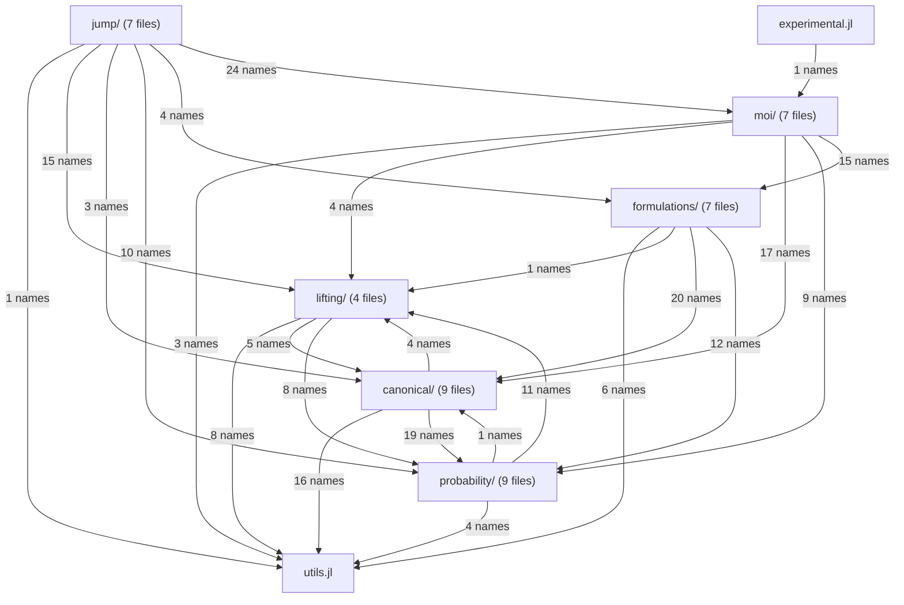

# Structure of `src/`: current (generated)

Generated by `docs/structure.jl` from the source; do not edit by hand.
See [the developer documentation](@ref developer_overview) for how to read it.

46 files, 694 top-level definitions (327 functions, 85 types, 23 constants), 47 exported names.

## Layers

An arrow `a → b` means that files of `a` use names defined in `b`; red arrows include uses of files that are included later (late binding).

## Include order

1. [`src/LinearDecisionRules.jl`](https://github.com/bfpc/LinearDecisionRules.jl/blob/main/src/LinearDecisionRules.jl): The module: imports, includes and the export list.
2. [`src/utils.jl`](https://github.com/bfpc/LinearDecisionRules.jl/blob/main/src/utils.jl): Generic helpers with no type of the package: sparse triplets, union–find, timing, lists of names.
3. [`src/probability/laws.jl`](https://github.com/bfpc/LinearDecisionRules.jl/blob/main/src/probability/laws.jl): The interface of a law, with its fallbacks: support (box, `support_constraints`, representation, membership test), atoms, moments and the trait of the dual bound.
4. [`src/lifting/lifting.jl`](https://github.com/bfpc/LinearDecisionRules.jl/blob/main/src/lifting/lifting.jl): The lifting interface (`AbstractLifting`, `lift`, `retraction`), and `LiftingMap`.
5. [`src/lifting/axis_piecewise.jl`](https://github.com/bfpc/LinearDecisionRules.jl/blob/main/src/lifting/axis_piecewise.jl): `AxisPiecewise`: the map, the box and hull of its lifted support, and the moments of its pieces.
6. [`src/lifting/combination_piecewise.jl`](https://github.com/bfpc/LinearDecisionRules.jl/blob/main/src/lifting/combination_piecewise.jl): `CombinationPiecewise` (experimental): the pieces of a combination of uncertainties, and the outer approximation of the hull of its lifted support.
7. [`src/probability/distributions/conditioned_distribution.jl`](https://github.com/bfpc/LinearDecisionRules.jl/blob/main/src/probability/distributions/conditioned_distribution.jl): `ConditionedDistribution`: laws conditioned by `Truncate()` rows, sampled by rejection.
8. [`src/probability/distributions/confidence_mv_normal.jl`](https://github.com/bfpc/LinearDecisionRules.jl/blob/main/src/probability/distributions/confidence_mv_normal.jl): `ConfidenceMvNormal`: a normal law truncated to a confidence ellipsoid.
9. [`src/probability/distributions/mv_discrete_non_parametric.jl`](https://github.com/bfpc/LinearDecisionRules.jl/blob/main/src/probability/distributions/mv_discrete_non_parametric.jl): `MvDiscreteNonParametric`: a multivariate law with finitely many atoms.
10. [`src/probability/distributions/lifted_distribution.jl`](https://github.com/bfpc/LinearDecisionRules.jl/blob/main/src/probability/distributions/lifted_distribution.jl): `LiftedDistribution`: the law of the lifted coordinates of an uncertainty.
11. [`src/probability/distributions/sum_law.jl`](https://github.com/bfpc/LinearDecisionRules.jl/blob/main/src/probability/distributions/sum_law.jl): `_SumLaw`: the law of a sum of independent discrete and uniform terms, and its stop-loss transforms in closed form, for the moments of combinations.
12. [`src/probability/distributions/combination_law.jl`](https://github.com/bfpc/LinearDecisionRules.jl/blob/main/src/probability/distributions/combination_law.jl): `_CombinationLaw`: the joint law of the inputs of `CombinationPiecewise` liftings and of their pieces, with its moments.
13. [`src/canonical/declarations.jl`](https://github.com/bfpc/LinearDecisionRules.jl/blob/main/src/canonical/declarations.jl): `ModelInfo` and `UncertaintyDeclaration`: what `canonicalize` reads besides the MOI model.
14. [`src/canonical/types.jl`](https://github.com/bfpc/LinearDecisionRules.jl/blob/main/src/canonical/types.jl): `CanonicalForm` and the types of its parts, and the cone helpers shared by every layer.
15. [`src/canonical/names.jl`](https://github.com/bfpc/LinearDecisionRules.jl/blob/main/src/canonical/names.jl): Names of variables and constraints, and printing of MOI functions and sets, for the messages.
16. [`src/canonical/read.jl`](https://github.com/bfpc/LinearDecisionRules.jl/blob/main/src/canonical/read.jl): The reader of an MOI model: rows, bounds, objective and parameters of the canonical form.
17. [`src/canonical/information_structure.jl`](https://github.com/bfpc/LinearDecisionRules.jl/blob/main/src/canonical/information_structure.jl): `InformationStructure`: which columns of ξ each decision observes.
18. [`src/canonical/checks.jl`](https://github.com/bfpc/LinearDecisionRules.jl/blob/main/src/canonical/checks.jl): Checks of a canonical form once read: valid rows at the mean, observable equalities, a convex objective.
19. [`src/canonical/support.jl`](https://github.com/bfpc/LinearDecisionRules.jl/blob/main/src/canonical/support.jl): `SupportBlock` and `support_blocks` (Ξ as a product of blocks), and the choice of representation of the supports.
20. [`src/canonical/conditioning.jl`](https://github.com/bfpc/LinearDecisionRules.jl/blob/main/src/canonical/conditioning.jl): `_condition`: the transform that conditions laws by the rows tagged `Truncate()`.
21. [`src/lifting/lifted_form.jl`](https://github.com/bfpc/LinearDecisionRules.jl/blob/main/src/lifting/lifted_form.jl): `lift(form, liftings)`: the lifted canonical form.
22. [`src/canonical/canonicalize.jl`](https://github.com/bfpc/LinearDecisionRules.jl/blob/main/src/canonical/canonicalize.jl): `canonicalize`: the reader, the transforms of the laws, the checks and the liftings, in order.
23. [`src/probability/rejection_sampling.jl`](https://github.com/bfpc/LinearDecisionRules.jl/blob/main/src/probability/rejection_sampling.jl): The rejection sampling of the conditioned laws: settings, time limits, the cache of the estimates, and the estimator.
24. [`src/probability/moments.jl`](https://github.com/bfpc/LinearDecisionRules.jl/blob/main/src/probability/moments.jl): `Moments` and `CovarianceBlock`, `moments`, and the block-diagonal moment algebra (products, covariance, singular blocks).
25. [`src/formulations/interface.jl`](https://github.com/bfpc/LinearDecisionRules.jl/blob/main/src/formulations/interface.jl): `AbstractFormulation`, `FormulationCapabilities` and `capabilities`, and the `_build!` hook.
26. [`src/formulations/rows.jl`](https://github.com/bfpc/LinearDecisionRules.jl/blob/main/src/formulations/rows.jl): What the formulations share: the rule variables, the linear rows and inequalities, the equalities and the objective.
27. [`src/formulations/primal.jl`](https://github.com/bfpc/LinearDecisionRules.jl/blob/main/src/formulations/primal.jl): `PrimalLDR` and its `_build!`: robust counterparts per support block, closed form on boxes.
28. [`src/formulations/dual.jl`](https://github.com/bfpc/LinearDecisionRules.jl/blob/main/src/formulations/dual.jl): `DualLDR` and its `_build!`: the structured dual cones, and the stage-dependence warning.
29. [`src/formulations/sampled.jl`](https://github.com/bfpc/LinearDecisionRules.jl/blob/main/src/formulations/sampled.jl): `SampledLDR` and its `_build!`: constraints on sampled outcomes.
30. [`src/formulations/result.jl`](https://github.com/bfpc/LinearDecisionRules.jl/blob/main/src/formulations/result.jl): `FormulationResult`: statuses, objective value and bound, certification, and the result of a time limit.
31. [`src/formulations/inner.jl`](https://github.com/bfpc/LinearDecisionRules.jl/blob/main/src/formulations/inner.jl): The inner problem: `solve_formulation`, its build, its solve within a time limit, and the parameters as stage-0 decisions.
32. [`src/moi/sets.jl`](https://github.com/bfpc/LinearDecisionRules.jl/blob/main/src/moi/sets.jl): The MOI sets `Uncertainty` (uni- and multivariate) and `Stage`.
33. [`src/moi/attributes.jl`](https://github.com/bfpc/LinearDecisionRules.jl/blob/main/src/moi/attributes.jl): The tags (`ValidInequality`, `Truncate`) and the MOI attributes, public and internal.
34. [`src/moi/model_info.jl`](https://github.com/bfpc/LinearDecisionRules.jl/blob/main/src/moi/model_info.jl): `model_info`: reads the tags of a model into a `ModelInfo`.
35. [`src/moi/checks.jl`](https://github.com/bfpc/LinearDecisionRules.jl/blob/main/src/moi/checks.jl): Whole-model checks run by `optimize!` (convex objective, singular moments).
36. [`src/moi/inner_cache.jl`](https://github.com/bfpc/LinearDecisionRules.jl/blob/main/src/moi/inner_cache.jl): The cache of inner problems for re-solves, with its fingerprint.
37. [`src/moi/optimizer.jl`](https://github.com/bfpc/LinearDecisionRules.jl/blob/main/src/moi/optimizer.jl): `Optimizer`: attributes, supported constraints, and `MOI.optimize!`.
38. [`src/moi/results.jl`](https://github.com/bfpc/LinearDecisionRules.jl/blob/main/src/moi/results.jl): The results of the optimizer: statuses, values, bounds, slots, and internal attributes for the JuMP layer.
39. [`src/jump/variables.jl`](https://github.com/bfpc/LinearDecisionRules.jl/blob/main/src/jump/variables.jl): `Stage` tags on variables, vector uncertainties over containers, and `stage`/`set_stage`/`unset_stage`.
40. [`src/jump/constraints.jl`](https://github.com/bfpc/LinearDecisionRules.jl/blob/main/src/jump/constraints.jl): Tags on constraints (`ValidInequality()`, `Truncate()`), and the error of a `Stage` tag.
41. [`src/jump/checks.jl`](https://github.com/bfpc/LinearDecisionRules.jl/blob/main/src/jump/checks.jl): Declaration-time checks of uncertainties and stages.
42. [`src/jump/model.jl`](https://github.com/bfpc/LinearDecisionRules.jl/blob/main/src/jump/model.jl): `LDRModel`.
43. [`src/jump/results.jl`](https://github.com/bfpc/LinearDecisionRules.jl/blob/main/src/jump/results.jl): JuMP functions per formulation (`objective_value(model, f)`, …), `is_certified` and `inner_model`.
44. [`src/jump/rules.jl`](https://github.com/bfpc/LinearDecisionRules.jl/blob/main/src/jump/rules.jl): `decision_rule`, `expected_value`, `rule_coefficient`, `rule_matrix`.
45. [`src/jump/simulate.jl`](https://github.com/bfpc/LinearDecisionRules.jl/blob/main/src/jump/simulate.jl): `evaluate` and `simulate`, and the `SimulationData` the optimizer gives them.
46. [`src/experimental.jl`](https://github.com/bfpc/LinearDecisionRules.jl/blob/main/src/experimental.jl): The `Experimental` submodule: `set_breakpoints` on combinations of uncertainties.

## Uses of files included later

None: every file uses only names defined in files included before it.

## Cycles between files

None.

## Files

For each file: what it defines, which files it uses (and for what), and which files use it. Exported names are in **bold**; names with a docstring are marked †.

### `LinearDecisionRules`

The module: imports, includes and the export list.

[`src/LinearDecisionRules.jl`](https://github.com/bfpc/LinearDecisionRules.jl/blob/main/src/LinearDecisionRules.jl): 134 lines.

### `utils`

Generic helpers with no type of the package: sparse triplets, union–find, timing, lists of names.

[`src/utils.jl`](https://github.com/bfpc/LinearDecisionRules.jl/blob/main/src/utils.jl): 82 lines.

Defines:
`_SparseMatrix` (L8), `_nonzero_columns` (L11), `_Triplets` (L16) (2 methods), `_push!` (L24), `_sparse` (L33), `_symmetric` (L35), `_UnionFind` (L38) (2 methods), `_root!` (L44), `_join!` (L53), `_groups` (L63), `_seconds_since` (L76), `_name_list` (L79).

Used by: `lifting/axis_piecewise` (1), `probability/distributions/lifted_distribution` (1), `probability/distributions/combination_law` (1), `canonical/types` (1), `canonical/read` (3), `canonical/support` (8), `canonical/conditioning` (4), `lifting/lifted_form` (7), `probability/rejection_sampling` (1), `probability/moments` (1), `formulations/rows` (1), `formulations/dual` (2), `formulations/result` (1), `formulations/inner` (2), `moi/checks` (1), `moi/inner_cache` (1), `moi/optimizer` (1), `jump/simulate` (1).

### `probability/laws`

The interface of a law, with its fallbacks: support (box, `support_constraints`, representation, membership test), atoms, moments and the trait of the dual bound.

[`src/probability/laws.jl`](https://github.com/bfpc/LinearDecisionRules.jl/blob/main/src/probability/laws.jl): 197 lines.

Defines:
`_dimension` (L11) (3 methods), `_SupportCone` (L16), `_support_bounds` (L21) (2 methods), `_support_box` (L36), `_box_rows` (L48), **`support_constraints` (L76)**†, `_no_support_constraints` (L80), `_has_auto_representation` (L86), `_resolve_representation` (L88), `_cone_violation` (L91) (2 methods), `_outside_cone` (L102) (3 methods), `_CONDITIONING_TOLERANCE` (L128), `_finite_atoms` (L132) (2 methods), `_law_mean` (L150) (3 methods), `_law_covariance` (L153) (3 methods), `_linear_conditional_expectations` (L161) (4 methods), `_ContinuousTruncated` (L178), `_truncated_moments` (L187).

Used by: `probability/distributions/conditioned_distribution` (8), `probability/distributions/confidence_mv_normal` (6), `probability/distributions/mv_discrete_non_parametric` (2), `probability/distributions/lifted_distribution` (3), `probability/distributions/combination_law` (9), `canonical/read` (1), `canonical/checks` (2), `canonical/support` (6), `canonical/conditioning` (5), `lifting/lifted_form` (1), `probability/moments` (2), `formulations/dual` (2), `moi/sets` (1), `moi/optimizer` (1), `jump/simulate` (6).

### `lifting/lifting`

The lifting interface (`AbstractLifting`, `lift`, `retraction`), and `LiftingMap`.

[`src/lifting/lifting.jl`](https://github.com/bfpc/LinearDecisionRules.jl/blob/main/src/lifting/lifting.jl): 164 lines.

Defines:
**`AbstractLifting` (L24)**†, **`lift` (L33)**† (4 methods), **`retraction` (L43)**† (2 methods), **`LiftingBlock` (L58)**†, **`LiftingMap` (L88)**†, `_keeps_inputs` (L101), `_column_of` (L104), `_block_of` (L107), `_input` (L113), `_column_labels` (L119).

Used by: `lifting/axis_piecewise` (3), `lifting/combination_piecewise` (4), `probability/distributions/lifted_distribution` (2), `probability/distributions/combination_law` (1), `canonical/types` (1), `lifting/lifted_form` (5), `formulations/dual` (1), `moi/results` (1), `jump/rules` (8), `jump/simulate` (3).

### `lifting/axis_piecewise`

`AxisPiecewise`: the map, the box and hull of its lifted support, and the moments of its pieces.

[`src/lifting/axis_piecewise.jl`](https://github.com/bfpc/LinearDecisionRules.jl/blob/main/src/lifting/axis_piecewise.jl): 177 lines.

Defines:
**`AxisPiecewise` (L44)**†, `Base.==` (L60), `Base.hash` (L62), `_num_inputs` (L64), `_num_lifted` (L66), **`lift` (L68)** (extends `lifting/lifting`), **`retraction` (L82)** (extends `lifting/lifting`), `_vertices` (L86), `_lifted_bounds` (L100), `_hull_rows` (L112), `Base.show` (L127), `_lifted_moments` (L138), `_piece_moments` (L167) (2 methods).

Uses:

- `utils`: `_symmetric`
- `lifting/lifting`: `AbstractLifting`, `lift`, `retraction`

Used by: `lifting/combination_piecewise` (5), `probability/distributions/lifted_distribution` (5), `probability/distributions/combination_law` (2), `lifting/lifted_form` (4).

### `lifting/combination_piecewise`

`CombinationPiecewise` (experimental): the pieces of a combination of uncertainties, and the outer approximation of the hull of its lifted support.

[`src/lifting/combination_piecewise.jl`](https://github.com/bfpc/LinearDecisionRules.jl/blob/main/src/lifting/combination_piecewise.jl): 161 lines.

Defines:
`CombinationPiecewise` (L43)†, `Base.==` (L70), `Base.hash` (L76), `_num_inputs` (L80) (extends `lifting/axis_piecewise`), `_num_lifted` (L82) (extends `lifting/axis_piecewise`), `_keeps_inputs` (L84) (extends `lifting/lifting`), `_combination` (L86), **`lift` (L90)** (extends `lifting/lifting`), **`retraction` (L106)** (extends `lifting/lifting`), `_vertices` (L110) (extends `lifting/axis_piecewise`), `_lifted_bounds` (L123) (extends `lifting/axis_piecewise`), `_hull_rows` (L132) (extends `lifting/axis_piecewise`), `Base.show` (L156).

Uses:

- `lifting/lifting`: `AbstractLifting`, `_keeps_inputs`, `lift`, `retraction`
- `lifting/axis_piecewise`: `_hull_rows`, `_lifted_bounds`, `_num_inputs`, `_num_lifted`, `_vertices`

Used by: `probability/distributions/combination_law` (1), `lifting/lifted_form` (1), `jump/rules` (1).

### `probability/distributions/conditioned_distribution`

`ConditionedDistribution`: laws conditioned by `Truncate()` rows, sampled by rejection.

[`src/probability/distributions/conditioned_distribution.jl`](https://github.com/bfpc/LinearDecisionRules.jl/blob/main/src/probability/distributions/conditioned_distribution.jl): 205 lines.

Defines:
**`ConditionedDistribution` (L58)**†, `Base.length` (L105), `Base.eltype` (L107), `Distributions.params` (L109), `Base.minimum` (L111), `Base.maximum` (L115), `Base.==` (L121), `Base.hash` (L125), `Base.show` (L129), `_constraint_names` (L135), `_draw_candidates!` (L141), `_in_set` (L155), `_MAX_ATTEMPTS_PER_DRAW` (L164), `Distributions._rand!` (L166), **`support_constraints` (L187)** (extends `probability/laws`), `_has_auto_representation` (L199) (extends `probability/laws`), `_resolve_representation` (L201) (extends `probability/laws`).

Uses:

- `probability/laws`: `_CONDITIONING_TOLERANCE`, `_SupportCone`, `_dimension`, `_has_auto_representation`, `_outside_cone`, `_resolve_representation`, `_support_box`, `support_constraints`

Used by: `canonical/checks` (1), `canonical/conditioning` (3), `lifting/lifted_form` (2), `probability/rejection_sampling` (4), `probability/moments` (1).

### `probability/distributions/confidence_mv_normal`

`ConfidenceMvNormal`: a normal law truncated to a confidence ellipsoid.

[`src/probability/distributions/confidence_mv_normal.jl`](https://github.com/bfpc/LinearDecisionRules.jl/blob/main/src/probability/distributions/confidence_mv_normal.jl): 185 lines.

Defines:
**`ConfidenceMvNormal` (L61)**†, `Base.length` (L98), `Base.eltype` (L100), `Distributions.params` (L102), `Distributions.mean` (L104), `Distributions.cov` (L106), `Distributions.var` (L108), `Base.minimum` (L110), `Base.maximum` (L112), `Base.==` (L115), `Base.hash` (L119), `Base.show` (L123), `Distributions.insupport` (L131), `Distributions._rand!` (L137), **`support_constraints` (L153)** (extends `probability/laws`), `_linear_conditional_expectations` (L178) (extends `probability/laws`), `_has_auto_representation` (L180) (extends `probability/laws`), `_resolve_representation` (L182) (extends `probability/laws`).

Uses:

- `probability/laws`: `_SupportCone`, `_has_auto_representation`, `_linear_conditional_expectations`, `_no_support_constraints`, `_resolve_representation`, `support_constraints`

### `probability/distributions/mv_discrete_non_parametric`

`MvDiscreteNonParametric`: a multivariate law with finitely many atoms.

[`src/probability/distributions/mv_discrete_non_parametric.jl`](https://github.com/bfpc/LinearDecisionRules.jl/blob/main/src/probability/distributions/mv_discrete_non_parametric.jl): 163 lines.

Defines:
**`MvDiscreteNonParametric` (L27)**† (2 methods), `Base.eltype` (L66), `Distributions.params` (L68), `Base.length` (L70), `Distributions._rand!` (L72), `Base.minimum` (L88), `Base.maximum` (L96), `Distributions.mean` (L104), `Distributions.cov` (L112), `Distributions.var` (L122), `Distributions.insupport` (L131), `_finite_atoms` (L134) (extends `probability/laws`), `_linear_conditional_expectations` (L143) (extends `probability/laws`).

Uses:

- `probability/laws`: `_finite_atoms`, `_linear_conditional_expectations`

Used by: `canonical/conditioning` (1).

### `probability/distributions/lifted_distribution`

`LiftedDistribution`: the law of the lifted coordinates of an uncertainty.

[`src/probability/distributions/lifted_distribution.jl`](https://github.com/bfpc/LinearDecisionRules.jl/blob/main/src/probability/distributions/lifted_distribution.jl): 129 lines.

Defines:
**`LiftedDistribution` (L43)**† (2 methods), `Base.length` (L69), `Base.eltype` (L73), `Distributions.params` (L75), `Base.minimum` (L77), `Base.maximum` (L79), `_box_rows` (L84) (extends `probability/laws`), `Distributions.mean` (L91), `Distributions.cov` (L93), `Distributions.var` (L95), `Distributions._rand!` (L97), `Base.show` (L106), `_lifted_moments` (L113) (extends `lifting/axis_piecewise`).

Uses:

- `utils`: `_symmetric`
- `probability/laws`: `_box_rows`, `_support_bounds`, `_support_box`
- `lifting/lifting`: `AbstractLifting`, `lift`
- `lifting/axis_piecewise`: `AxisPiecewise`, `_lifted_bounds`, `_lifted_moments`, `_num_inputs`, `_num_lifted`

Used by: `lifting/lifted_form` (1), `jump/simulate` (1).

### `probability/distributions/sum_law`

`_SumLaw`: the law of a sum of independent discrete and uniform terms, and its stop-loss transforms in closed form, for the moments of combinations.

[`src/probability/distributions/sum_law.jl`](https://github.com/bfpc/LinearDecisionRules.jl/blob/main/src/probability/distributions/sum_law.jl): 202 lines.

Defines:
`_MAX_COMBINATION_ATOMS` (L13), `_too_many_atoms` (L15), `_DiscreteTerm` (L25), `_UniformTerm` (L30), `_SumLaw` (L40) (2 methods), `_EXACT_PRECISION` (L55), `_subset_sums` (L97), `_uniform_closed_form` (L118) (2 methods), `_uniform_stop_loss` (L153), `_uniform_density` (L166), `_stop_loss` (L174), `_stop_loss_knots` (L185), `_piecewise_integral` (L191).

Used by: `probability/distributions/combination_law` (10).

### `probability/distributions/combination_law`

`_CombinationLaw`: the joint law of the inputs of `CombinationPiecewise` liftings and of their pieces, with its moments.

[`src/probability/distributions/combination_law.jl`](https://github.com/bfpc/LinearDecisionRules.jl/blob/main/src/probability/distributions/combination_law.jl): 534 lines.

Defines:
`_CombinationLaw` (L24)† (2 methods), `_components` (L40) (3 methods), `_offsets` (L48), `_laws_of` (L53), `_local_coefficients` (L58), `_combination_range` (L69), `_piece_positions` (L143), `_combination_moments` (L151), `_pieces_of_hinges` (L215), `_sum_term` (L225), `_hinge_moments` (L238), `_hinge_coordinate_moments` (L260) (2 methods), `_hinge_cross_moments` (L297), `_expectation` (L364), `_integrate` (L385), `Base.length` (L427), `Base.eltype` (L429), `Base.minimum` (L431), `Base.maximum` (L433), `Distributions.mean` (L435), `Distributions.cov` (L437), `Distributions.var` (L439), `_num_original` (L442), `_box_rows` (L446) (extends `probability/laws`), **`support_constraints` (L466)** (extends `probability/laws`), `_embed_rows` (L504), `_linear_conditional_expectations` (L512) (extends `probability/laws`), `Distributions._rand!` (L516), `Base.show` (L531).

Uses:

- `utils`: `_symmetric`
- `probability/laws`: `_SupportCone`, `_box_rows`, `_dimension`, `_finite_atoms`, `_law_covariance`, `_law_mean`, `_linear_conditional_expectations`, `_support_box`, `support_constraints`
- `lifting/lifting`: `lift`
- `lifting/axis_piecewise`: `_lifted_bounds`, `_num_lifted`
- `lifting/combination_piecewise`: `CombinationPiecewise`
- `probability/distributions/sum_law`: `_DiscreteTerm`, `_MAX_COMBINATION_ATOMS`, `_SumLaw`, `_UniformTerm`, `_piecewise_integral`, `_stop_loss`, `_stop_loss_knots`, `_too_many_atoms`, `_uniform_density`, `_uniform_stop_loss`

Used by: `lifting/lifted_form` (4), `jump/variables` (1), `jump/simulate` (1).

### `canonical/declarations`

`ModelInfo` and `UncertaintyDeclaration`: what `canonicalize` reads besides the MOI model.

[`src/canonical/declarations.jl`](https://github.com/bfpc/LinearDecisionRules.jl/blob/main/src/canonical/declarations.jl): 80 lines.

Defines:
`UncertaintyDeclaration` (L25)† (2 methods), `ModelInfo` (L71)†.

Used by: `canonical/read` (1), `canonical/canonicalize` (1), `moi/model_info` (2), `moi/optimizer` (1).

### `canonical/types`

`CanonicalForm` and the types of its parts, and the cone helpers shared by every layer.

[`src/canonical/types.jl`](https://github.com/bfpc/LinearDecisionRules.jl/blob/main/src/canonical/types.jl): 260 lines.

Defines:
`_BoundSet` (L9), `_ScalarFunction` (L12), `_VectorFunction` (L16), `_VectorSet` (L18), `ConicRow` (L42)†, `UncertaintyBlock` (L66)†, `ParameterTerms` (L99)†, `Base.==` (L112), `Base.hash` (L116), `_has_parameter_terms` (L121), `CanonicalForm` (L206)†, `_replace` (L245), `Base.show` (L254).

Uses:

- `utils`: `_SparseMatrix`
- `lifting/lifting`: `LiftingMap`

Used by: `canonical/read` (8), `canonical/information_structure` (1), `canonical/checks` (1), `canonical/support` (3), `canonical/conditioning` (3), `lifting/lifted_form` (4), `probability/moments` (1), `formulations/rows` (1), `formulations/primal` (1), `formulations/dual` (1), `formulations/sampled` (1), `formulations/result` (1), `formulations/inner` (3), `moi/checks` (1), `moi/inner_cache` (2), `moi/optimizer` (5), `jump/simulate` (1).

### `canonical/names`

Names of variables and constraints, and printing of MOI functions and sets, for the messages.

[`src/canonical/names.jl`](https://github.com/bfpc/LinearDecisionRules.jl/blob/main/src/canonical/names.jl): 88 lines.

Defines:
`_variable_name` (L9), `_constraint_name` (L18), `_number_string` (L27), `_terms_string` (L30), `_function_string` (L49) (5 methods), `_set_string` (L76) (6 methods).

Used by: `canonical/read` (2), `canonical/checks` (1), `canonical/conditioning` (1), `lifting/lifted_form` (1), `moi/model_info` (1), `moi/optimizer` (1), `jump/simulate` (2).

### `canonical/read`

The reader of an MOI model: rows, bounds, objective and parameters of the canonical form.

[`src/canonical/read.jl`](https://github.com/bfpc/LinearDecisionRules.jl/blob/main/src/canonical/read.jl): 708 lines.

Defines:
`_is_metadata_constraint` (L15)†, `_bounds` (L17) (4 methods), `_scalar_set` (L22) (3 methods), `_Columns` (L27), `_add_term!` (L40), `_add_product!` (L52), `_read!` (L71) (2 methods), `_Row` (L93) (2 methods), `_reset!` (L107), `_add_parameter!` (L117) (2 methods), `_parameter_value` (L123), `_add_decision!` (L131) (2 methods), `_add_uncertainty!` (L136) (2 methods), `_add_constant!` (L141) (2 methods), `_add_bilinear!` (L147) (2 methods), `_Objective` (L159) (2 methods), `_RowBlock` (L210) (2 methods), `_push_row!` (L222), `_ValidRows` (L246) (2 methods), `_Layout` (L256), `_Constraints` (L268) (2 methods), `_parameter_list` (L297), `_check_declarations` (L311), `_layout` (L357), `_warn_unmarked` (L395), `_read_constraints` (L409), `_read_constraints!` (L421) (5 methods), `_read_row!` (L553), `_check_row` (L576), `_push_valid_row!` (L595), `_check_uncertainty_only_row` (L622), `_read_objective` (L640), `_canonical_form` (L655).

Uses:

- `utils`: `_Triplets`, `_push!`, `_sparse`
- `probability/laws`: `_dimension`
- `canonical/declarations`: `ModelInfo`
- `canonical/types`: `CanonicalForm`, `ConicRow`, `ParameterTerms`, `UncertaintyBlock`, `_BoundSet`, `_ScalarFunction`, `_VectorFunction`, `_VectorSet`
- `canonical/names`: `_constraint_name`, `_variable_name`

Used by: `canonical/canonicalize` (6), `moi/sets` (1), `moi/optimizer` (1).

### `canonical/information_structure`

`InformationStructure`: which columns of ξ each decision observes.

[`src/canonical/information_structure.jl`](https://github.com/bfpc/LinearDecisionRules.jl/blob/main/src/canonical/information_structure.jl): 65 lines.

Defines:
`InformationStructure` (L28)† (2 methods), `observes` (L58)†, `visible_columns` (L65)†.

Uses:

- `canonical/types`: `CanonicalForm`

Used by: `canonical/checks` (1), `formulations/rows` (2), `formulations/primal` (1), `formulations/dual` (1), `formulations/sampled` (1).

### `canonical/checks`

Checks of a canonical form once read: valid rows at the mean, observable equalities, a convex objective.

[`src/canonical/checks.jl`](https://github.com/bfpc/LinearDecisionRules.jl/blob/main/src/canonical/checks.jl): 97 lines.

Defines:
`_check_valid_rows_at_mean` (L13), `_check_observable_equalities` (L58), `_nonconvex_decisions` (L84).

Uses:

- `probability/laws`: `_cone_violation`, `_law_mean`
- `probability/distributions/conditioned_distribution`: `ConditionedDistribution`
- `canonical/types`: `CanonicalForm`
- `canonical/names`: `_constraint_name`
- `canonical/information_structure`: `InformationStructure`

Used by: `canonical/canonicalize` (2), `formulations/result` (1), `moi/checks` (1).

### `canonical/support`

`SupportBlock` and `support_blocks` (Ξ as a product of blocks), and the choice of representation of the supports.

[`src/canonical/support.jl`](https://github.com/bfpc/LinearDecisionRules.jl/blob/main/src/canonical/support.jl): 178 lines.

Defines:
`SupportBlock` (L30)†, `_cone_rows` (L40), `support_blocks` (L61)†, `_resolve_representations` (L170).

Uses:

- `utils`: `_SparseMatrix`, `_Triplets`, `_UnionFind`, `_groups`, `_join!`, `_nonzero_columns`, `_push!`, `_sparse`
- `probability/laws`: `_SupportCone`, `_box_rows`, `_has_auto_representation`, `_resolve_representation`, `_support_box`, `support_constraints`
- `canonical/types`: `CanonicalForm`, `UncertaintyBlock`, `_replace`

Used by: `canonical/canonicalize` (1), `formulations/primal` (3), `formulations/dual` (3).

### `canonical/conditioning`

`_condition`: the transform that conditions laws by the rows tagged `Truncate()`.

[`src/canonical/conditioning.jl`](https://github.com/bfpc/LinearDecisionRules.jl/blob/main/src/canonical/conditioning.jl): 213 lines.

Defines:
`_condition` (L11), `_row_names` (L93), `_conditioned_block` (L101), `_MAX_PRODUCT_ATOMS` (L149), `_discrete_conditioned_law` (L156), `_truncated_law` (L188).

Uses:

- `utils`: `_UnionFind`, `_groups`, `_join!`, `_nonzero_columns`
- `probability/laws`: `_CONDITIONING_TOLERANCE`, `_SupportCone`, `_finite_atoms`, `_outside_cone`, `_support_box`
- `probability/distributions/conditioned_distribution`: `ConditionedDistribution`, `_constraint_names`, `_in_set`
- `probability/distributions/mv_discrete_non_parametric`: `MvDiscreteNonParametric`
- `canonical/types`: `CanonicalForm`, `UncertaintyBlock`, `_replace`
- `canonical/names`: `_constraint_name`

Used by: `canonical/canonicalize` (1).

### `lifting/lifted_form`

`lift(form, liftings)`: the lifted canonical form.

[`src/lifting/lifted_form.jl`](https://github.com/bfpc/LinearDecisionRules.jl/blob/main/src/lifting/lifted_form.jl): 482 lines.

Defines:
**`lift` (L35)**† (extends `lifting/lifting`), `_lift` (L49), `_liftings_by_column` (L177), `_lifted_laws` (L211), `_combination_columns` (L238), `_combination_laws` (L277), `_combination_name` (L341), `_short` (L353), `_combination_liftings` (L359), `_form_combination_range` (L401), `_lifting_map` (L413), `_original_uncertainties` (L428), `_original_names` (L432), `_breakpoint_liftings` (L438), `_named_lifting_error` (L475).

Uses:

- `utils`: `_Triplets`, `_UnionFind`, `_join!`, `_push!`, `_root!`, `_seconds_since`, `_sparse`
- `probability/laws`: `_support_box`
- `lifting/lifting`: `AbstractLifting`, `LiftingBlock`, `LiftingMap`, `lift`, `retraction`
- `lifting/axis_piecewise`: `AxisPiecewise`, `_hull_rows`, `_num_inputs`, `_num_lifted`
- `lifting/combination_piecewise`: `CombinationPiecewise`
- `probability/distributions/conditioned_distribution`: `ConditionedDistribution`, `_constraint_names`
- `probability/distributions/lifted_distribution`: `LiftedDistribution`
- `probability/distributions/combination_law`: `_CombinationLaw`, `_combination_range`, `_components`, `_offsets`
- `canonical/types`: `CanonicalForm`, `ConicRow`, `UncertaintyBlock`, `_replace`
- `canonical/names`: `_variable_name`

Used by: `canonical/canonicalize` (3), `moi/optimizer` (1), `moi/results` (2), `jump/simulate` (3).

### `canonical/canonicalize`

`canonicalize`: the reader, the transforms of the laws, the checks and the liftings, in order.

[`src/canonical/canonicalize.jl`](https://github.com/bfpc/LinearDecisionRules.jl/blob/main/src/canonical/canonicalize.jl): 104 lines.

Defines:
`canonicalize` (L77)†, `_canonicalize` (L83).

Uses:

- `canonical/declarations`: `ModelInfo`
- `canonical/read`: `_canonical_form`, `_check_declarations`, `_layout`, `_parameter_list`, `_read_constraints`, `_read_objective`
- `canonical/checks`: `_check_observable_equalities`, `_check_valid_rows_at_mean`
- `canonical/support`: `_resolve_representations`
- `canonical/conditioning`: `_condition`
- `lifting/lifted_form`: `_breakpoint_liftings`, `_combination_liftings`, `_lift`

Used by: `moi/optimizer` (1).

### `probability/rejection_sampling`

The rejection sampling of the conditioned laws: settings, time limits, the cache of the estimates, and the estimator.

[`src/probability/rejection_sampling.jl`](https://github.com/bfpc/LinearDecisionRules.jl/blob/main/src/probability/rejection_sampling.jl): 140 lines.

Defines:
`_RejectionSampling` (L11), `_DEFAULT_SAMPLING_TIME_LIMIT` (L32), `_sampling_time_limit` (L38), `_sampling_time_limit_source` (L48), `_Estimate` (L61), `_MomentsCache` (L72) (2 methods), `_MIN_SAMPLES` (L81), `_estimate` (L89), `_check_estimate` (L126).

Uses:

- `utils`: `_seconds_since`
- `probability/distributions/conditioned_distribution`: `ConditionedDistribution`, `_constraint_names`, `_draw_candidates!`, `_in_set`

Used by: `probability/moments` (6), `moi/optimizer` (2).

### `probability/moments`

`Moments` and `CovarianceBlock`, `moments`, and the block-diagonal moment algebra (products, covariance, singular blocks).

[`src/probability/moments.jl`](https://github.com/bfpc/LinearDecisionRules.jl/blob/main/src/probability/moments.jl): 225 lines.

Defines:
`CovarianceBlock` (L25)† (2 methods), `Moments` (L50)†, `_is_estimated` (L57), `moments` (L84)†, `_moments` (L95), `second_moment` (L166)†, `_product_moment` (L175), `_covariance_matrix` (L183), `_singular_blocks` (L200), `_singular_laws` (L220).

Uses:

- `utils`: `_name_list`
- `probability/laws`: `_law_covariance`, `_law_mean`
- `probability/distributions/conditioned_distribution`: `ConditionedDistribution`
- `canonical/types`: `CanonicalForm`
- `probability/rejection_sampling`: `_MomentsCache`, `_RejectionSampling`, `_check_estimate`, `_estimate`, `_sampling_time_limit`, `_sampling_time_limit_source`

Used by: `formulations/rows` (1), `formulations/primal` (1), `formulations/dual` (2), `formulations/sampled` (2), `formulations/result` (3), `formulations/inner` (1), `moi/checks` (2), `moi/inner_cache` (1), `moi/optimizer` (2), `jump/rules` (1).

### `formulations/interface`

`AbstractFormulation`, `FormulationCapabilities` and `capabilities`, and the `_build!` hook.

[`src/formulations/interface.jl`](https://github.com/bfpc/LinearDecisionRules.jl/blob/main/src/formulations/interface.jl): 51 lines.

Defines:
**`AbstractFormulation` (L17)**†, `_attribute_pairs` (L19), `_formulation_attributes` (L21), `FormulationCapabilities` (L37)†, `capabilities` (L47)†, `_build!` (L51).

Used by: `formulations/primal` (5), `formulations/dual` (6), `formulations/sampled` (4), `formulations/result` (2), `formulations/inner` (3), `moi/attributes` (1), `moi/inner_cache` (1), `moi/optimizer` (1), `moi/results` (2), `jump/results` (1), `jump/rules` (1), `jump/simulate` (2).

### `formulations/rows`

What the formulations share: the rule variables, the linear rows and inequalities, the equalities and the objective.

[`src/formulations/rows.jl`](https://github.com/bfpc/LinearDecisionRules.jl/blob/main/src/formulations/rows.jl): 222 lines.

Defines:
`_rule_variables!` (L16), `_LinearRow` (L46), `_structural_columns` (L56), `_is_deterministic` (L60), `_linear_rows` (L64), `_Inequality` (L75), `_inequalities` (L82), `_add_row_column!` (L97), `_add_equalities!` (L107), `_add_deterministic!` (L116), `_objective_constant` (L123), `_set_objective!` (L138), `_add_quadratic_terms!` (L172), `_decision_means!` (L206).

Uses:

- `utils`: `_SparseMatrix`
- `canonical/types`: `CanonicalForm`
- `canonical/information_structure`: `InformationStructure`, `visible_columns`
- `probability/moments`: `Moments`

Used by: `formulations/primal` (9), `formulations/dual` (9), `formulations/sampled` (6).

### `formulations/primal`

`PrimalLDR` and its `_build!`: robust counterparts per support block, closed form on boxes.

[`src/formulations/primal.jl`](https://github.com/bfpc/LinearDecisionRules.jl/blob/main/src/formulations/primal.jl): 241 lines.

Defines:
**`PrimalLDR` (L37)**† (2 methods), `Base.==` (L52), `Base.hash` (L54), `capabilities` (L56) (extends `formulations/interface`), `_block_of_columns` (L61), `_touched_blocks` (L71), `_multipliers!` (L84), `_box_bounds` (L104), `_add_box_counterpart!` (L141), `_add_robust_counterpart!` (L186), `_build!` (L222) (extends `formulations/interface`).

Uses:

- `canonical/types`: `CanonicalForm`
- `canonical/information_structure`: `InformationStructure`
- `canonical/support`: `SupportBlock`, `_cone_rows`, `support_blocks`
- `probability/moments`: `Moments`
- `formulations/interface`: `AbstractFormulation`, `FormulationCapabilities`, `_attribute_pairs`, `_build!`, `capabilities`
- `formulations/rows`: `_Inequality`, `_LinearRow`, `_add_deterministic!`, `_add_equalities!`, `_add_row_column!`, `_inequalities`, `_is_deterministic`, `_rule_variables!`, `_set_objective!`

Used by: `formulations/dual` (1), `moi/optimizer` (1), `moi/results` (1).

### `formulations/dual`

`DualLDR` and its `_build!`: the structured dual cones, and the stage-dependence warning.

[`src/formulations/dual.jl`](https://github.com/bfpc/LinearDecisionRules.jl/blob/main/src/formulations/dual.jl): 244 lines.

Defines:
**`DualLDR` (L53)**† (2 methods), `Base.==` (L63), `Base.hash` (L65), `Base.show` (L67), `_formulation_attributes` (L84) (extends `formulations/interface`), `capabilities` (L86) (extends `formulations/interface`), `_DualCone` (L90), `_dual_cones` (L97), `_add_dual_cone!` (L112), `_stage_dependent_laws` (L173), `_check_combinations_across_stages` (L189), `_warn_stage_dependence` (L210), `_build!` (L224) (extends `formulations/interface`).

Uses:

- `utils`: `_SparseMatrix`, `_name_list`
- `probability/laws`: `_SupportCone`, `_linear_conditional_expectations`
- `lifting/lifting`: `_keeps_inputs`
- `canonical/types`: `CanonicalForm`
- `canonical/information_structure`: `InformationStructure`
- `canonical/support`: `SupportBlock`, `_cone_rows`, `support_blocks`
- `probability/moments`: `Moments`, `_covariance_matrix`
- `formulations/interface`: `AbstractFormulation`, `FormulationCapabilities`, `_attribute_pairs`, `_build!`, `_formulation_attributes`, `capabilities`
- `formulations/rows`: `_Inequality`, `_add_deterministic!`, `_add_equalities!`, `_add_row_column!`, `_inequalities`, `_is_deterministic`, `_rule_variables!`, `_set_objective!`, `_structural_columns`
- `formulations/primal`: `PrimalLDR`

Used by: `formulations/result` (1), `moi/optimizer` (2).

### `formulations/sampled`

`SampledLDR` and its `_build!`: constraints on sampled outcomes.

[`src/formulations/sampled.jl`](https://github.com/bfpc/LinearDecisionRules.jl/blob/main/src/formulations/sampled.jl): 95 lines.

Defines:
**`SampledLDR` (L18)**† (2 methods), `Base.show` (L32), `capabilities` (L37) (extends `formulations/interface`), `_sample_outcomes` (L43), `_empirical_moments` (L55), `_build!` (L66) (extends `formulations/interface`).

Uses:

- `canonical/types`: `CanonicalForm`
- `canonical/information_structure`: `InformationStructure`
- `probability/moments`: `CovarianceBlock`, `Moments`
- `formulations/interface`: `AbstractFormulation`, `FormulationCapabilities`, `_build!`, `capabilities`
- `formulations/rows`: `_add_deterministic!`, `_add_equalities!`, `_inequalities`, `_is_deterministic`, `_rule_variables!`, `_set_objective!`

Used by: `moi/results` (1).

### `formulations/result`

`FormulationResult`: statuses, objective value and bound, certification, and the result of a time limit.

[`src/formulations/result.jl`](https://github.com/bfpc/LinearDecisionRules.jl/blob/main/src/formulations/result.jl): 225 lines.

Defines:
`FormulationResult` (L49)†, `Base.show` (L64), `_certification` (L72), `_raw_status` (L95), `_time_limit_result` (L100), `_has_integers` (L119), `_is_linear_program` (L126), `_dual_objective_or` (L138), `_objective_bound` (L152), `_NO_SOLUTION_STATUS` (L179), `_formulation_result` (L182).

Uses:

- `utils`: `_seconds_since`
- `canonical/types`: `CanonicalForm`
- `canonical/checks`: `_nonconvex_decisions`
- `probability/moments`: `Moments`, `_is_estimated`, `_singular_blocks`
- `formulations/interface`: `AbstractFormulation`, `capabilities`
- `formulations/dual`: `_stage_dependent_laws`

Used by: `formulations/inner` (2), `moi/optimizer` (1), `moi/results` (1).

### `formulations/inner`

The inner problem: `solve_formulation`, its build, its solve within a time limit, and the parameters as stage-0 decisions.

[`src/formulations/inner.jl`](https://github.com/bfpc/LinearDecisionRules.jl/blob/main/src/formulations/inner.jl): 205 lines.

Defines:
`solve_formulation` (L46)†, `_InnerProblem` (L63), `_build_inner` (L73), `_solve_inner!` (L105), `_solve!` (L135), `_with_parameter_decisions` (L163), `_with_constant_column` (L196).

Uses:

- `utils`: `_SparseMatrix`, `_seconds_since`
- `canonical/types`: `CanonicalForm`, `_has_parameter_terms`, `_replace`
- `probability/moments`: `Moments`
- `formulations/interface`: `AbstractFormulation`, `_build!`, `_formulation_attributes`
- `formulations/result`: `_formulation_result`, `_time_limit_result`

Used by: `moi/inner_cache` (1), `moi/optimizer` (2).

### `moi/sets`

The MOI sets `Uncertainty` (uni- and multivariate) and `Stage`.

[`src/moi/sets.jl`](https://github.com/bfpc/LinearDecisionRules.jl/blob/main/src/moi/sets.jl): 145 lines.

Defines:
`UnivariateUncertainty` (L11)†, `MultivariateUncertainty` (L20)†, **`Uncertainty` (L41)**† (3 methods), `_AnyUncertainty` (L58), `MOI.dimension` (L60), `Base.copy` (L63), `_same_distribution` (L66), `Base.==` (L72), `Base.hash` (L77), `Base.show` (L79) (3 methods), **`Stage` (L98)**†, **`FirstStage` (L115)**†, `_law_name` (L117) (2 methods), `_unbounded_support_message` (L122), `_is_metadata_constraint` (L133) (3 methods) (extends `canonical/read`), `MOI.FileFormats.MOF.head_name` (L141) (3 methods).

Uses:

- `probability/laws`: `_support_bounds`
- `canonical/read`: `_is_metadata_constraint`

Used by: `moi/model_info` (2), `moi/optimizer` (4), `jump/variables` (2), `jump/constraints` (1), `jump/checks` (4).

### `moi/attributes`

The tags (`ValidInequality`, `Truncate`) and the MOI attributes, public and internal.

[`src/moi/attributes.jl`](https://github.com/bfpc/LinearDecisionRules.jl/blob/main/src/moi/attributes.jl): 338 lines.

Defines:
`AbstractXiRole` (L12)†, `Base.broadcastable` (L15), **`ValidInequality` (L29)**†, **`Truncate` (L57)**†, `XiRole` (L66)†, **`BreakPoints` (L88)**†, `CombinationBreakPoints` (L98)†, `MOI.Utilities.map_indices` (L100) (2 methods), **`InnerOptimizer` (L116)**†, **`Formulations` (L135)**†, **`RejectionSamplingSeed` (L149)**†, **`RejectionSamplingTimeLimit` (L177)**†, **`RejectionSamplingMaxSamples` (L200)**†, **`FormulationAttribute` (L215)**†, `MOI.is_set_by_optimize` (L220) (4 methods), **`Certified` (L235)**†, **`TimeBreakdown` (L262)**†, `_TIME_PHASES` (L266), `_TimeBreakdown` (L268), `_no_time_breakdown` (L270), `RuleCoefficients` (L278), `UncertaintyVariables` (L284), `DecisionVariables` (L287), `UncertaintyLifting` (L290), `UncertaintyMoments` (L293), `SimulationData` (L296), `InnerModel` (L301), `_AttributesWithoutIndices` (L319).

Uses:

- `formulations/interface`: `AbstractFormulation`

Used by: `moi/model_info` (5), `moi/optimizer` (10), `moi/results` (9), `jump/constraints` (2), `jump/results` (4), `jump/rules` (5), `jump/simulate` (2), `experimental` (1).

### `moi/model_info`

`model_info`: reads the tags of a model into a `ModelInfo`.

[`src/moi/model_info.jl`](https://github.com/bfpc/LinearDecisionRules.jl/blob/main/src/moi/model_info.jl): 120 lines.

Defines:
`_variable_stages` (L8), `_uncertainty_declarations` (L16), `_xi_roles` (L35), `_breakpoints` (L55), `_combinations` (L77), `model_info` (L106)†.

Uses:

- `canonical/declarations`: `ModelInfo`, `UncertaintyDeclaration`
- `canonical/names`: `_variable_name`
- `moi/sets`: `Stage`, `_AnyUncertainty`
- `moi/attributes`: `BreakPoints`, `CombinationBreakPoints`, `Truncate`, `ValidInequality`, `XiRole`

Used by: `moi/optimizer` (1).

### `moi/checks`

Whole-model checks run by `optimize!` (convex objective, singular moments).

[`src/moi/checks.jl`](https://github.com/bfpc/LinearDecisionRules.jl/blob/main/src/moi/checks.jl): 38 lines.

Defines:
`_check_convex_objective` (L11), `_warn_singular_moments` (L27).

Uses:

- `utils`: `_name_list`
- `canonical/types`: `CanonicalForm`
- `canonical/checks`: `_nonconvex_decisions`
- `probability/moments`: `Moments`, `_singular_laws`

Used by: `moi/optimizer` (2).

### `moi/inner_cache`

The cache of inner problems for re-solves, with its fingerprint.

[`src/moi/inner_cache.jl`](https://github.com/bfpc/LinearDecisionRules.jl/blob/main/src/moi/inner_cache.jl): 130 lines.

Defines:
`_same_value` (L20), `_same_fields` (L27) (7 methods), `_same_except_constant` (L60), `_same_form` (L72), `_Fingerprint` (L91), `_same_problem` (L99), `_InnerCache` (L109) (2 methods), `_update!` (L118), `_cached_problem` (L127).

Uses:

- `utils`: `_SparseMatrix`
- `canonical/types`: `CanonicalForm`, `ParameterTerms`
- `probability/moments`: `Moments`
- `formulations/interface`: `AbstractFormulation`
- `formulations/inner`: `_InnerProblem`

Used by: `moi/optimizer` (5).

### `moi/optimizer`

`Optimizer`: attributes, supported constraints, and `MOI.optimize!`.

[`src/moi/optimizer.jl`](https://github.com/bfpc/LinearDecisionRules.jl/blob/main/src/moi/optimizer.jl): 431 lines.

Defines:
`Optimizer` (L70)†, `MOI.is_empty` (L118), `MOI.empty!` (L120), `MOI.get` (L132) (10 methods), `MOI.supports_incremental_interface` (L135), `MOI.supports_constraint` (L138) (5 methods), `MOI.supports` (L164) (7 methods), `MOI.set` (L226) (9 methods), `_inner_factory` (L310), `MOI.copy_to` (L321), `_identity_map` (L326), `_check_bounded_support` (L340), `_inner_supports_cones` (L354), `_parameter_values` (L361), `MOI.optimize!` (L375)†.

Uses:

- `utils`: `_seconds_since`
- `probability/laws`: `_has_auto_representation`
- `canonical/declarations`: `ModelInfo`
- `canonical/types`: `CanonicalForm`, `_BoundSet`, `_ScalarFunction`, `_VectorFunction`, `_VectorSet`
- `canonical/names`: `_variable_name`
- `canonical/read`: `_parameter_list`
- `lifting/lifted_form`: `_original_uncertainties`
- `canonical/canonicalize`: `_canonicalize`
- `probability/rejection_sampling`: `_MomentsCache`, `_RejectionSampling`
- `probability/moments`: `Moments`, `_moments`
- `formulations/interface`: `AbstractFormulation`
- `formulations/primal`: `PrimalLDR`
- `formulations/dual`: `DualLDR`, `_check_combinations_across_stages`
- `formulations/result`: `FormulationResult`
- `formulations/inner`: `_build_inner`, `_solve!`
- `moi/sets`: `MultivariateUncertainty`, `Stage`, `UnivariateUncertainty`, `_unbounded_support_message`
- `moi/attributes`: `BreakPoints`, `CombinationBreakPoints`, `Formulations`, `InnerOptimizer`, `RejectionSamplingMaxSamples`, `RejectionSamplingSeed`, `RejectionSamplingTimeLimit`, `XiRole`, `_TimeBreakdown`, `_no_time_breakdown`
- `moi/model_info`: `model_info`
- `moi/checks`: `_check_convex_objective`, `_warn_singular_moments`
- `moi/inner_cache`: `_Fingerprint`, `_InnerCache`, `_cached_problem`, `_same_value`, `_update!`

Used by: `moi/results` (1), `jump/model` (1), `jump/simulate` (1).

### `moi/results`

The results of the optimizer: statuses, values, bounds, slots, and internal attributes for the JuMP layer.

[`src/moi/results.jl`](https://github.com/bfpc/LinearDecisionRules.jl/blob/main/src/moi/results.jl): 246 lines.

Defines:
`_find_result` (L15), `_has_rule` (L20), `_is_bound` (L22), `_has_solution` (L24), `_RESULT_SLOTS` (L28), `_slot_result` (L30), `MOI.get` (L37) (26 methods), `_solution_of_slot` (L51), `_termination_status` (L70), `_rank` (L86), `MOI.Utilities.map_indices` (L99) (2 methods), `_rule_coefficients` (L127), `_require_result` (L153), `_require_value` (L168).

Uses:

- `lifting/lifting`: `retraction`
- `lifting/lifted_form`: `_lifting_map`, `_original_uncertainties`
- `formulations/interface`: `AbstractFormulation`, `capabilities`
- `formulations/primal`: `PrimalLDR`
- `formulations/sampled`: `SampledLDR`
- `formulations/result`: `FormulationResult`
- `moi/attributes`: `Certified`, `DecisionVariables`, `FormulationAttribute`, `InnerModel`, `RuleCoefficients`, `TimeBreakdown`, `UncertaintyLifting`, `UncertaintyMoments`, `UncertaintyVariables`
- `moi/optimizer`: `Optimizer`

Used by: `jump/simulate` (2).

### `jump/variables`

`Stage` tags on variables, vector uncertainties over containers, and `stage`/`set_stage`/`unset_stage`.

[`src/jump/variables.jl`](https://github.com/bfpc/LinearDecisionRules.jl/blob/main/src/jump/variables.jl): 193 lines.

Defines:
`_StagedVariable` (L11), `_StagedVariables` (L17), `JuMP.build_variable` (L22) (9 methods), `_build_staged_variables` (L51), `JuMP.add_variable` (L72) (4 methods), `_ArrayOfVariables` (L98), `_components` (L121) (2 methods) (extends `probability/distributions/combination_law`), `_like` (L125) (2 methods), `_stage_constraint` (L141), **`stage` (L157)**†, **`set_stage` (L169)**†, **`unset_stage` (L187)**†.

Uses:

- `probability/distributions/combination_law`: `_components`
- `moi/sets`: `MultivariateUncertainty`, `Stage`

Used by: `jump/checks` (2).

### `jump/constraints`

Tags on constraints (`ValidInequality()`, `Truncate()`), and the error of a `Stage` tag.

[`src/jump/constraints.jl`](https://github.com/bfpc/LinearDecisionRules.jl/blob/main/src/jump/constraints.jl): 99 lines.

Defines:
`_TaggedConstraint` (L8), `_check_tagged_row` (L13), `JuMP.build_constraint` (L20) (6 methods), `JuMP.add_constraint` (L58), `_constraint_stage_message` (L96).

Uses:

- `moi/sets`: `Stage`
- `moi/attributes`: `AbstractXiRole`, `XiRole`

### `jump/checks`

Declaration-time checks of uncertainties and stages.

[`src/jump/checks.jl`](https://github.com/bfpc/LinearDecisionRules.jl/blob/main/src/jump/checks.jl): 90 lines.

Defines:
`_error_two_stages` (L9), `JuMP.build_variable` (L13) (6 methods), `_variable_info` (L26) (3 methods), `_check_uncertainty_declaration` (L32).

Uses:

- `moi/sets`: `MultivariateUncertainty`, `Stage`, `UnivariateUncertainty`, `_unbounded_support_message`
- `jump/variables`: `_StagedVariable`, `_build_staged_variables`

### `jump/model`

`LDRModel`.

[`src/jump/model.jl`](https://github.com/bfpc/LinearDecisionRules.jl/blob/main/src/jump/model.jl): 25 lines.

Defines:
**`LDRModel` (L23)**†.

Uses:

- `moi/optimizer`: `Optimizer`

### `jump/results`

JuMP functions per formulation (`objective_value(model, f)`, …), `is_certified` and `inner_model`.

[`src/jump/results.jl`](https://github.com/bfpc/LinearDecisionRules.jl/blob/main/src/jump/results.jl): 167 lines.

Defines:
`_formulation_attribute` (L9), `_optimize_not_called` (L15), `JuMP.termination_status` (L25)†, `JuMP.primal_status` (L39)†, `JuMP.objective_value` (L54)†, `JuMP.objective_bound` (L63)†, `JuMP.raw_status` (L72)†, `JuMP.solve_time` (L82)†, **`time_breakdown` (L100)**† (2 methods), **`is_certified` (L134)**†, **`inner_model` (L165)**†.

Uses:

- `formulations/interface`: `AbstractFormulation`
- `moi/attributes`: `Certified`, `FormulationAttribute`, `InnerModel`, `TimeBreakdown`

### `jump/rules`

`decision_rule`, `expected_value`, `rule_coefficient`, `rule_matrix`.

[`src/jump/rules.jl`](https://github.com/bfpc/LinearDecisionRules.jl/blob/main/src/jump/rules.jl): 367 lines.

Defines:
**`LiftedTerm` (L14)**†, `(::LiftedTerm)` (L19), `CombinationTerm` (L33)†, `(::CombinationTerm)` (L39), **`DecisionRule` (L73)**† (2 methods), `(::DecisionRule)` (L88) (2 methods), `_by_index` (L104), `Base.show` (L106) (2 methods), **`decision_rule` (L140)**†, `_a_variable` (L170) (4 methods), **`expected_value` (L196)**† (2 methods), **`rule_coefficient` (L250)**†, **`RuleMatrix` (L297)**†, `Base.size` (L305), `Base.getindex` (L307), **`rule_matrix` (L357)**†.

Uses:

- `lifting/lifting`: `AbstractLifting`, `LiftingMap`, `_block_of`, `_column_labels`, `_column_of`, `_input`, `_keeps_inputs`, `lift`
- `lifting/combination_piecewise`: `CombinationPiecewise`
- `probability/moments`: `_product_moment`
- `formulations/interface`: `AbstractFormulation`
- `moi/attributes`: `DecisionVariables`, `RuleCoefficients`, `UncertaintyLifting`, `UncertaintyMoments`, `UncertaintyVariables`

### `jump/simulate`

`evaluate` and `simulate`, and the `SimulationData` the optimizer gives them.

[`src/jump/simulate.jl`](https://github.com/bfpc/LinearDecisionRules.jl/blob/main/src/jump/simulate.jl): 713 lines.

Defines:
`_OriginalLaw` (L13) (2 methods), `_outside_law_rows` (L26), `_RowGroup` (L34), `_Simulator` (L38), `_original_laws` (L58), `_stack_rows` (L83), `MOI.get` (L118), `_simulator` (L149), `_Given` (L163), `_add_scenario!` (L167) (2 methods), `_add_pair!` (L176) (3 methods), `_outcome` (L198), `_check_outside_support` (L225), `_Batch` (L235), `_assess` (L243), `_group_name` (L264), `_support_reasons` (L278), **`Evaluation` (L356)**†, `_lookup` (L367), `JuMP.value` (L381)† (2 methods), `Base.getindex` (L385), `Base.broadcastable` (L388), `JuMP.objective_value` (L395)†, `Base.show` (L397) (2 methods), `_handle_outside_support` (L408), **`evaluate` (L456)**† (3 methods), **`Simulation` (L517)**†, `_draw_chunk` (L548), `_simulate` (L558), **`simulate` (L663)**† (2 methods).

Uses:

- `utils`: `_SparseMatrix`
- `probability/laws`: `_SupportCone`, `_cone_violation`, `_dimension`, `_outside_cone`, `_support_box`, `support_constraints`
- `lifting/lifting`: `_column_of`, `_input`, `lift`
- `probability/distributions/lifted_distribution`: `LiftedDistribution`
- `probability/distributions/combination_law`: `_CombinationLaw`
- `canonical/types`: `CanonicalForm`
- `canonical/names`: `_constraint_name`, `_number_string`
- `lifting/lifted_form`: `_lifting_map`, `_original_names`, `_original_uncertainties`
- `formulations/interface`: `AbstractFormulation`, `capabilities`
- `moi/attributes`: `FormulationAttribute`, `SimulationData`
- `moi/optimizer`: `Optimizer`
- `moi/results`: `_has_solution`, `_require_result`

### `experimental`

The `Experimental` submodule: `set_breakpoints` on combinations of uncertainties.

[`src/experimental.jl`](https://github.com/bfpc/LinearDecisionRules.jl/blob/main/src/experimental.jl): 87 lines.

Defines:
`set_breakpoints` (L51)†, `_same` (L82).

Uses:

- `moi/attributes`: `CombinationBreakPoints`

