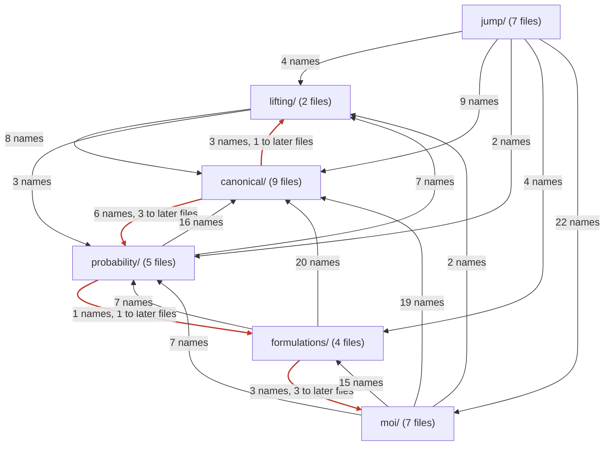

# Structure of `src/`: current (generated)

Generated by `docs/structure.jl` from the source; do not edit by hand.
See [the developer documentation](@ref developer_overview) for how to read it.

35 files, 591 top-level definitions (275 functions, 76 types, 19 constants), 45 exported names.

## Layers

An arrow `a → b` means that files of `a` use names defined in `b`; red arrows include uses of files that are included later (late binding).

## Include order

1. [`src/LinearDecisionRules.jl`](https://github.com/bfpc/LinearDecisionRules.jl/blob/main/src/LinearDecisionRules.jl): The module: imports, includes and the export list.
2. [`src/lifting/lifting.jl`](https://github.com/bfpc/LinearDecisionRules.jl/blob/main/src/lifting/lifting.jl): The lifting interface (`AbstractLifting`, `lift`, `retraction`), `AxisPiecewise`, and `LiftingMap`.
3. [`src/canonical/info.jl`](https://github.com/bfpc/LinearDecisionRules.jl/blob/main/src/canonical/info.jl): `ModelInfo` and `UncertaintyDeclaration`: what `canonicalize` reads besides the MOI model.
4. [`src/canonical/types.jl`](https://github.com/bfpc/LinearDecisionRules.jl/blob/main/src/canonical/types.jl): `CanonicalForm` and the types of its parts, and helpers shared by every layer (sparse triplets, cones).
5. [`src/canonical/names.jl`](https://github.com/bfpc/LinearDecisionRules.jl/blob/main/src/canonical/names.jl): Names of variables and constraints, and printing of MOI functions and sets, for the messages.
6. [`src/canonical/read.jl`](https://github.com/bfpc/LinearDecisionRules.jl/blob/main/src/canonical/read.jl): The reader of an MOI model: rows, bounds, objective and parameters of the canonical form.
7. [`src/canonical/checks.jl`](https://github.com/bfpc/LinearDecisionRules.jl/blob/main/src/canonical/checks.jl): Checks of a canonical form once read: valid rows at the mean, observable equalities.
8. [`src/canonical/canonicalize.jl`](https://github.com/bfpc/LinearDecisionRules.jl/blob/main/src/canonical/canonicalize.jl): `canonicalize`: the reader, the transforms of the laws, the checks and the liftings, in order.
9. [`src/canonical/information.jl`](https://github.com/bfpc/LinearDecisionRules.jl/blob/main/src/canonical/information.jl): `InformationStructure`: which columns of ξ each decision observes.
10. [`src/canonical/support.jl`](https://github.com/bfpc/LinearDecisionRules.jl/blob/main/src/canonical/support.jl): `SupportBlock` and `support_blocks` (Ξ as a product of blocks), and the support hooks of the laws.
11. [`src/probability/distributions/conditioned_distribution.jl`](https://github.com/bfpc/LinearDecisionRules.jl/blob/main/src/probability/distributions/conditioned_distribution.jl): `ConditionedDistribution`: laws conditioned by `Truncate()` rows, sampled by rejection.
12. [`src/probability/distributions/confidence_mv_normal.jl`](https://github.com/bfpc/LinearDecisionRules.jl/blob/main/src/probability/distributions/confidence_mv_normal.jl): `ConfidenceMvNormal`: a normal law truncated to a confidence ellipsoid.
13. [`src/canonical/conditioning.jl`](https://github.com/bfpc/LinearDecisionRules.jl/blob/main/src/canonical/conditioning.jl): `_condition`: the transform that conditions laws by the rows tagged `Truncate()`.
14. [`src/probability/moments.jl`](https://github.com/bfpc/LinearDecisionRules.jl/blob/main/src/probability/moments.jl): `Moments` and `CovarianceBlock`, the moment hooks of the laws, and the rejection-sampling engine.
15. [`src/probability/distributions/mv_discrete_non_parametric.jl`](https://github.com/bfpc/LinearDecisionRules.jl/blob/main/src/probability/distributions/mv_discrete_non_parametric.jl): `MvDiscreteNonParametric`: a multivariate law with finitely many atoms.
16. [`src/probability/distributions/lifted_distribution.jl`](https://github.com/bfpc/LinearDecisionRules.jl/blob/main/src/probability/distributions/lifted_distribution.jl): `LiftedDistribution`, and the moments of `AxisPiecewise` pieces.
17. [`src/lifting/lifted_form.jl`](https://github.com/bfpc/LinearDecisionRules.jl/blob/main/src/lifting/lifted_form.jl): `lift(form, liftings)`: the lifted canonical form.
18. [`src/formulations/formulation.jl`](https://github.com/bfpc/LinearDecisionRules.jl/blob/main/src/formulations/formulation.jl): The formulation types, capabilities, `FormulationResult`, `solve_formulation`, the inner problem, the shared rows and objective.
19. [`src/formulations/primal.jl`](https://github.com/bfpc/LinearDecisionRules.jl/blob/main/src/formulations/primal.jl): `_build!` for `PrimalLDR`: robust counterparts per support block, closed form on boxes.
20. [`src/formulations/dual.jl`](https://github.com/bfpc/LinearDecisionRules.jl/blob/main/src/formulations/dual.jl): `_build!` for `DualLDR`: the structured dual cones, and the stage-dependence warning.
21. [`src/formulations/sampled.jl`](https://github.com/bfpc/LinearDecisionRules.jl/blob/main/src/formulations/sampled.jl): `_build!` for `SampledLDR`: constraints on sampled outcomes.
22. [`src/moi/sets.jl`](https://github.com/bfpc/LinearDecisionRules.jl/blob/main/src/moi/sets.jl): The MOI sets `Uncertainty` (uni- and multivariate) and `Stage`.
23. [`src/moi/attributes.jl`](https://github.com/bfpc/LinearDecisionRules.jl/blob/main/src/moi/attributes.jl): The tags (`ValidInequality`, `Truncate`) and the MOI attributes, public and internal.
24. [`src/moi/model_info.jl`](https://github.com/bfpc/LinearDecisionRules.jl/blob/main/src/moi/model_info.jl): `model_info`: reads the tags of a model into a `ModelInfo`.
25. [`src/moi/checks.jl`](https://github.com/bfpc/LinearDecisionRules.jl/blob/main/src/moi/checks.jl): Whole-model checks run by `optimize!` (convex objective, singular moments) and their helpers.
26. [`src/moi/inner_cache.jl`](https://github.com/bfpc/LinearDecisionRules.jl/blob/main/src/moi/inner_cache.jl): The cache of inner problems for re-solves, with its fingerprint.
27. [`src/moi/optimizer.jl`](https://github.com/bfpc/LinearDecisionRules.jl/blob/main/src/moi/optimizer.jl): `Optimizer`: attributes, supported constraints, and `MOI.optimize!`.
28. [`src/moi/results.jl`](https://github.com/bfpc/LinearDecisionRules.jl/blob/main/src/moi/results.jl): The results of the optimizer: statuses, values, bounds, slots, and internal attributes for the JuMP layer.
29. [`src/jump/variables.jl`](https://github.com/bfpc/LinearDecisionRules.jl/blob/main/src/jump/variables.jl): `Stage` tags on variables, and `stage`/`set_stage`/`unset_stage`.
30. [`src/jump/constraints.jl`](https://github.com/bfpc/LinearDecisionRules.jl/blob/main/src/jump/constraints.jl): Tags on constraints (`ValidInequality()`, `Truncate()`), and the error of a `Stage` tag.
31. [`src/jump/checks.jl`](https://github.com/bfpc/LinearDecisionRules.jl/blob/main/src/jump/checks.jl): Declaration-time checks of uncertainties and stages, and vector uncertainties over containers.
32. [`src/jump/model.jl`](https://github.com/bfpc/LinearDecisionRules.jl/blob/main/src/jump/model.jl): `LDRModel`.
33. [`src/jump/results.jl`](https://github.com/bfpc/LinearDecisionRules.jl/blob/main/src/jump/results.jl): JuMP functions per formulation (`objective_value(model, f)`, …), `is_certified` and `inner_model`.
34. [`src/jump/rules.jl`](https://github.com/bfpc/LinearDecisionRules.jl/blob/main/src/jump/rules.jl): `decision_rule`, `expected_value`, `rule_coefficient`, `rule_matrix`.
35. [`src/jump/simulate.jl`](https://github.com/bfpc/LinearDecisionRules.jl/blob/main/src/jump/simulate.jl): `evaluate` and `simulate`, and the `SimulationData` the optimizer gives them.

## Uses of files included later

These uses work because Julia resolves names in function bodies when the function first runs. They read as a layer calling the one above it.

| File | uses, from a later file | names |
|---|---|---|
| `canonical/checks` | `canonical/information` | `InformationStructure` |
| `canonical/checks` | `probability/distributions/conditioned_distribution` | `ConditionedDistribution` |
| `canonical/checks` | `probability/moments` | `_law_mean` |
| `canonical/canonicalize` | `canonical/support` | `_resolve_supports` |
| `canonical/canonicalize` | `canonical/conditioning` | `_condition` |
| `canonical/canonicalize` | `lifting/lifted_form` | `_breakpoint_liftings` |
| `canonical/conditioning` | `probability/distributions/mv_discrete_non_parametric` | `MvDiscreteNonParametric` |
| `probability/moments` | `formulations/formulation` | `_seconds_since` |
| `formulations/formulation` | `formulations/dual` | `_stage_dependent_laws` |
| `formulations/formulation` | `moi/checks` | `_nonconvex_decisions`, `_singular_blocks` |
| `formulations/dual` | `moi/checks` | `_name_list` |

## Cycles between files

Groups of files that use each other, directly or through other files:

- `probability/moments`, `formulations/formulation`, `formulations/dual`, `moi/checks`
- `canonical/conditioning`, `probability/distributions/mv_discrete_non_parametric`

## Files

For each file: what it defines, which files it uses (and for what), and which files use it. Exported names are in **bold**; names with a docstring are marked †.

### `LinearDecisionRules`

The module: imports, includes and the export list.

[`src/LinearDecisionRules.jl`](https://github.com/bfpc/LinearDecisionRules.jl/blob/main/src/LinearDecisionRules.jl): 120 lines.

### `lifting/lifting`

The lifting interface (`AbstractLifting`, `lift`, `retraction`), `AxisPiecewise`, and `LiftingMap`.

[`src/lifting/lifting.jl`](https://github.com/bfpc/LinearDecisionRules.jl/blob/main/src/lifting/lifting.jl): 249 lines.

Defines:
**`AbstractLifting` (L24)**†, **`lift` (L33)**† (5 methods), **`retraction` (L43)**† (3 methods), **`AxisPiecewise` (L80)**†, `Base.==` (L96), `Base.hash` (L98), `_num_inputs` (L100), `_num_lifted` (L102), `_vertices` (L122), `_lifted_bounds` (L136), `_hull_rows` (L147), `Base.show` (L162), **`LiftingBlock` (L180)**†, **`LiftingMap` (L210)**†.

Used by: `canonical/types` (1), `canonical/canonicalize` (1), `probability/distributions/lifted_distribution` (7), `lifting/lifted_form` (9), `moi/results` (1), `jump/rules` (3), `jump/simulate` (1).

### `canonical/info`

`ModelInfo` and `UncertaintyDeclaration`: what `canonicalize` reads besides the MOI model.

[`src/canonical/info.jl`](https://github.com/bfpc/LinearDecisionRules.jl/blob/main/src/canonical/info.jl): 73 lines.

Defines:
`UncertaintyDeclaration` (L25)† (2 methods), `ModelInfo` (L66)†.

Used by: `canonical/read` (1), `canonical/canonicalize` (1), `moi/model_info` (2), `moi/optimizer` (1).

### `canonical/types`

`CanonicalForm` and the types of its parts, and helpers shared by every layer (sparse triplets, cones).

[`src/canonical/types.jl`](https://github.com/bfpc/LinearDecisionRules.jl/blob/main/src/canonical/types.jl): 329 lines.

Defines:
`_BoundSet` (L9), `_ScalarFunction` (L12), `_VectorFunction` (L16), `_VectorSet` (L18), `_SparseMatrix` (L20), `_SupportCone` (L23), `ConicRow` (L47)†, `_nonzero_columns` (L56), `_cone_violation` (L61) (2 methods), `_outside_cone` (L72) (3 methods), `_CONDITIONING_TOLERANCE` (L98), `UncertaintyBlock` (L116)†, `ParameterTerms` (L149)†, `Base.==` (L162), `Base.hash` (L166), `_has_parameter_terms` (L171), `CanonicalForm` (L256)†, `_replace` (L294), `Base.show` (L299), `_dimension` (L307) (3 methods), `_Triplets` (L312) (2 methods), `_push!` (L320), `_sparse` (L329).

Uses:

- `lifting/lifting`: `LiftingMap`

Used by: `canonical/read` (12), `canonical/checks` (2), `canonical/information` (1), `canonical/support` (10), `probability/distributions/conditioned_distribution` (4), `probability/distributions/confidence_mv_normal` (1), `canonical/conditioning` (7), `probability/moments` (1), `lifting/lifted_form` (6), `formulations/formulation` (4), `formulations/primal` (1), `formulations/dual` (3), `formulations/sampled` (1), `moi/checks` (1), `moi/inner_cache` (3), `moi/optimizer` (5), `jump/simulate` (5).

### `canonical/names`

Names of variables and constraints, and printing of MOI functions and sets, for the messages.

[`src/canonical/names.jl`](https://github.com/bfpc/LinearDecisionRules.jl/blob/main/src/canonical/names.jl): 88 lines.

Defines:
`_variable_name` (L9), `_constraint_name` (L18), `_number_string` (L27), `_terms_string` (L30), `_function_string` (L49) (5 methods), `_set_string` (L76) (6 methods).

Used by: `canonical/read` (2), `canonical/checks` (1), `canonical/conditioning` (1), `lifting/lifted_form` (1), `moi/model_info` (1), `moi/optimizer` (1), `jump/simulate` (2).

### `canonical/read`

The reader of an MOI model: rows, bounds, objective and parameters of the canonical form.

[`src/canonical/read.jl`](https://github.com/bfpc/LinearDecisionRules.jl/blob/main/src/canonical/read.jl): 708 lines.

Defines:
`_is_metadata_constraint` (L15)†, `_bounds` (L17) (4 methods), `_scalar_set` (L22) (3 methods), `_Columns` (L27), `_add_term!` (L40), `_add_product!` (L52), `_read!` (L71) (2 methods), `_Row` (L93) (2 methods), `_reset!` (L107), `_add_parameter!` (L117) (2 methods), `_parameter_value` (L123), `_add_decision!` (L131) (2 methods), `_add_uncertainty!` (L136) (2 methods), `_add_constant!` (L141) (2 methods), `_add_bilinear!` (L147) (2 methods), `_Objective` (L159) (2 methods), `_RowBlock` (L210) (2 methods), `_push_row!` (L222), `_ValidRows` (L246) (2 methods), `_Layout` (L256), `_Constraints` (L268) (2 methods), `_parameter_list` (L297), `_check_declarations` (L311), `_layout` (L357), `_warn_unmarked` (L395), `_read_constraints` (L409), `_read_constraints!` (L421) (5 methods), `_read_row!` (L553), `_check_row` (L576), `_push_valid_row!` (L595), `_check_uncertainty_only_row` (L622), `_read_objective` (L640), `_canonical_form` (L655).

Uses:

- `canonical/info`: `ModelInfo`
- `canonical/types`: `CanonicalForm`, `ConicRow`, `ParameterTerms`, `UncertaintyBlock`, `_BoundSet`, `_ScalarFunction`, `_Triplets`, `_VectorFunction`, `_VectorSet`, `_dimension`, `_push!`, `_sparse`
- `canonical/names`: `_constraint_name`, `_variable_name`

Used by: `canonical/canonicalize` (6), `moi/sets` (1), `moi/optimizer` (1).

### `canonical/checks`

Checks of a canonical form once read: valid rows at the mean, observable equalities.

[`src/canonical/checks.jl`](https://github.com/bfpc/LinearDecisionRules.jl/blob/main/src/canonical/checks.jl): 79 lines.

Defines:
`_check_valid_rows_at_mean` (L12), `_check_observable_equalities` (L57).

Uses:

- `canonical/types`: `CanonicalForm`, `_cone_violation`
- `canonical/names`: `_constraint_name`
- `canonical/information` (included later): `InformationStructure`
- `probability/distributions/conditioned_distribution` (included later): `ConditionedDistribution`
- `probability/moments` (included later): `_law_mean`

Used by: `canonical/canonicalize` (2).

### `canonical/canonicalize`

`canonicalize`: the reader, the transforms of the laws, the checks and the liftings, in order.

[`src/canonical/canonicalize.jl`](https://github.com/bfpc/LinearDecisionRules.jl/blob/main/src/canonical/canonicalize.jl): 91 lines.

Defines:
`canonicalize` (L77)†.

Uses:

- `lifting/lifting`: `lift`
- `canonical/info`: `ModelInfo`
- `canonical/read`: `_canonical_form`, `_check_declarations`, `_layout`, `_parameter_list`, `_read_constraints`, `_read_objective`
- `canonical/checks`: `_check_observable_equalities`, `_check_valid_rows_at_mean`
- `canonical/support` (included later): `_resolve_supports`
- `canonical/conditioning` (included later): `_condition`
- `lifting/lifted_form` (included later): `_breakpoint_liftings`

Used by: `moi/optimizer` (1).

### `canonical/information`

`InformationStructure`: which columns of ξ each decision observes.

[`src/canonical/information.jl`](https://github.com/bfpc/LinearDecisionRules.jl/blob/main/src/canonical/information.jl): 65 lines.

Defines:
`InformationStructure` (L28)† (2 methods), `observes` (L58)†, `visible_columns` (L65)†.

Uses:

- `canonical/types`: `CanonicalForm`

Used by: `canonical/checks` (1), `formulations/formulation` (2), `formulations/primal` (1), `formulations/dual` (1), `formulations/sampled` (1).

### `canonical/support`

`SupportBlock` and `support_blocks` (Ξ as a product of blocks), and the support hooks of the laws.

[`src/canonical/support.jl`](https://github.com/bfpc/LinearDecisionRules.jl/blob/main/src/canonical/support.jl): 259 lines.

Defines:
`SupportBlock` (L30)†, `_cone_rows` (L40), `_support_bounds` (L48) (2 methods), `_support_box` (L63), **`support_constraints` (L98)**†, `_no_support_constraints` (L102), `_has_auto_support` (L108), `_resolve_support` (L110), `_find_root!` (L112), `support_blocks` (L133)†, `_resolve_supports` (L251).

Uses:

- `canonical/types`: `CanonicalForm`, `UncertaintyBlock`, `_SparseMatrix`, `_SupportCone`, `_Triplets`, `_dimension`, `_nonzero_columns`, `_push!`, `_replace`, `_sparse`

Used by: `canonical/canonicalize` (1), `probability/distributions/conditioned_distribution` (4), `probability/distributions/confidence_mv_normal` (4), `canonical/conditioning` (2), `probability/distributions/lifted_distribution` (1), `lifting/lifted_form` (1), `formulations/primal` (3), `formulations/dual` (3), `moi/sets` (1), `moi/optimizer` (1), `jump/simulate` (2).

### `probability/distributions/conditioned_distribution`

`ConditionedDistribution`: laws conditioned by `Truncate()` rows, sampled by rejection.

[`src/probability/distributions/conditioned_distribution.jl`](https://github.com/bfpc/LinearDecisionRules.jl/blob/main/src/probability/distributions/conditioned_distribution.jl): 197 lines.

Defines:
**`ConditionedDistribution` (L50)**†, `Base.length` (L97), `Base.eltype` (L99), `Distributions.params` (L101), `Base.minimum` (L103), `Base.maximum` (L107), `Base.==` (L113), `Base.hash` (L117), `Base.show` (L121), `_constraint_names` (L127), `_draw_candidates!` (L133), `_in_set` (L147), `_MAX_ATTEMPTS_PER_DRAW` (L156), `Distributions._rand!` (L158), **`support_constraints` (L179)** (extends `canonical/support`), `_has_auto_support` (L191) (extends `canonical/support`), `_resolve_support` (L193) (extends `canonical/support`).

Uses:

- `canonical/types`: `_CONDITIONING_TOLERANCE`, `_SupportCone`, `_dimension`, `_outside_cone`
- `canonical/support`: `_has_auto_support`, `_resolve_support`, `_support_box`, `support_constraints`

Used by: `canonical/checks` (1), `canonical/conditioning` (3), `probability/moments` (4), `lifting/lifted_form` (2).

### `probability/distributions/confidence_mv_normal`

`ConfidenceMvNormal`: a normal law truncated to a confidence ellipsoid.

[`src/probability/distributions/confidence_mv_normal.jl`](https://github.com/bfpc/LinearDecisionRules.jl/blob/main/src/probability/distributions/confidence_mv_normal.jl): 186 lines.

Defines:
**`ConfidenceMvNormal` (L62)**†, `Base.length` (L99), `Base.eltype` (L101), `Distributions.params` (L103), `Distributions.mean` (L105), `Distributions.cov` (L107), `Distributions.var` (L109), `Base.minimum` (L111), `Base.maximum` (L113), `Base.==` (L116), `Base.hash` (L120), `Base.show` (L124), `Distributions.insupport` (L132), `Distributions._rand!` (L138), **`support_constraints` (L154)** (extends `canonical/support`), `_linear_conditional_expectations` (L179), `_has_auto_support` (L181) (extends `canonical/support`), `_resolve_support` (L183) (extends `canonical/support`).

Uses:

- `canonical/types`: `_SupportCone`
- `canonical/support`: `_has_auto_support`, `_no_support_constraints`, `_resolve_support`, `support_constraints`

Used by: `probability/moments` (1), `probability/distributions/mv_discrete_non_parametric` (1), `formulations/dual` (1).

### `canonical/conditioning`

`_condition`: the transform that conditions laws by the rows tagged `Truncate()`.

[`src/canonical/conditioning.jl`](https://github.com/bfpc/LinearDecisionRules.jl/blob/main/src/canonical/conditioning.jl): 240 lines.

Defines:
`_condition` (L11), `_row_names` (L100), `_conditioned_block` (L108), `_finite_atoms` (L156) (2 methods), `_MAX_PRODUCT_ATOMS` (L176), `_discrete_conditioned_law` (L183), `_truncated_law` (L215).

Uses:

- `canonical/types`: `CanonicalForm`, `UncertaintyBlock`, `_CONDITIONING_TOLERANCE`, `_SupportCone`, `_nonzero_columns`, `_outside_cone`, `_replace`
- `canonical/names`: `_constraint_name`
- `canonical/support`: `_find_root!`, `_support_box`
- `probability/distributions/conditioned_distribution`: `ConditionedDistribution`, `_constraint_names`, `_in_set`
- `probability/distributions/mv_discrete_non_parametric` (included later): `MvDiscreteNonParametric`

Used by: `canonical/canonicalize` (1), `probability/distributions/mv_discrete_non_parametric` (1).

### `probability/moments`

`Moments` and `CovarianceBlock`, the moment hooks of the laws, and the rejection-sampling engine.

[`src/probability/moments.jl`](https://github.com/bfpc/LinearDecisionRules.jl/blob/main/src/probability/moments.jl): 354 lines.

Defines:
`CovarianceBlock` (L25)† (2 methods), `Moments` (L50)†, `_is_estimated` (L57), `_law_mean` (L59) (3 methods), `_law_covariance` (L62) (3 methods), `_linear_conditional_expectations` (L70) (4 methods) (extends `probability/distributions/confidence_mv_normal`), `_ContinuousTruncated` (L87), `_truncated_moments` (L96), `_RejectionSampling` (L110), `_DEFAULT_SAMPLING_TIME_LIMIT` (L131), `_sampling_time_limit` (L137), `_sampling_time_limit_source` (L147), `_Estimate` (L160), `_MomentsCache` (L171) (2 methods), `_MIN_SAMPLES` (L180), `_estimate` (L188), `_check_estimate` (L225), `moments` (L266)†, `_moments` (L277), `second_moment` (L348)†.

Uses:

- `canonical/types`: `CanonicalForm`
- `probability/distributions/conditioned_distribution`: `ConditionedDistribution`, `_constraint_names`, `_draw_candidates!`, `_in_set`
- `probability/distributions/confidence_mv_normal`: `_linear_conditional_expectations`
- `formulations/formulation` (included later): `_seconds_since`

Used by: `canonical/checks` (1), `formulations/formulation` (2), `formulations/primal` (1), `formulations/dual` (1), `formulations/sampled` (2), `moi/checks` (2), `moi/inner_cache` (1), `moi/optimizer` (4), `jump/rules` (1).

### `probability/distributions/mv_discrete_non_parametric`

`MvDiscreteNonParametric`: a multivariate law with finitely many atoms.

[`src/probability/distributions/mv_discrete_non_parametric.jl`](https://github.com/bfpc/LinearDecisionRules.jl/blob/main/src/probability/distributions/mv_discrete_non_parametric.jl): 163 lines.

Defines:
**`MvDiscreteNonParametric` (L27)**† (2 methods), `Base.eltype` (L66), `Distributions.params` (L68), `Base.length` (L70), `Distributions._rand!` (L72), `Base.minimum` (L88), `Base.maximum` (L96), `Distributions.mean` (L104), `Distributions.cov` (L112), `Distributions.var` (L122), `Distributions.insupport` (L131), `_finite_atoms` (L134) (extends `canonical/conditioning`), `_linear_conditional_expectations` (L143) (extends `probability/distributions/confidence_mv_normal`).

Uses:

- `probability/distributions/confidence_mv_normal`: `_linear_conditional_expectations`
- `canonical/conditioning`: `_finite_atoms`

Used by: `canonical/conditioning` (1).

### `probability/distributions/lifted_distribution`

`LiftedDistribution`, and the moments of `AxisPiecewise` pieces.

[`src/probability/distributions/lifted_distribution.jl`](https://github.com/bfpc/LinearDecisionRules.jl/blob/main/src/probability/distributions/lifted_distribution.jl): 161 lines.

Defines:
**`LiftedDistribution` (L36)**† (2 methods), `Base.length` (L62), `Base.eltype` (L66), `Distributions.params` (L68), `Base.minimum` (L70), `Base.maximum` (L72), `Distributions.mean` (L74), `Distributions.cov` (L76), `Distributions.var` (L78), `Distributions._rand!` (L80), `Base.show` (L89), `_lifted_moments` (L96) (2 methods), `_symmetric` (L114), `_piece_moments` (L151) (2 methods).

Uses:

- `lifting/lifting`: `AbstractLifting`, `AxisPiecewise`, `_lifted_bounds`, `_num_inputs`, `_num_lifted`, `_vertices`, `lift`
- `canonical/support`: `_support_bounds`

Used by: `lifting/lifted_form` (1), `jump/simulate` (1).

### `lifting/lifted_form`

`lift(form, liftings)`: the lifted canonical form.

[`src/lifting/lifted_form.jl`](https://github.com/bfpc/LinearDecisionRules.jl/blob/main/src/lifting/lifted_form.jl): 254 lines.

Defines:
**`lift` (L35)**† (extends `lifting/lifting`), `_liftings_by_column` (L136), `_lifted_laws` (L170), `_lifting_map` (L195), `_breakpoint_liftings` (L210), `_named_lifting_error` (L247).

Uses:

- `lifting/lifting`: `AbstractLifting`, `AxisPiecewise`, `LiftingBlock`, `LiftingMap`, `_hull_rows`, `_num_inputs`, `_num_lifted`, `lift`, `retraction`
- `canonical/types`: `CanonicalForm`, `ConicRow`, `UncertaintyBlock`, `_Triplets`, `_push!`, `_sparse`
- `canonical/names`: `_variable_name`
- `canonical/support`: `_support_box`
- `probability/distributions/conditioned_distribution`: `ConditionedDistribution`, `_constraint_names`
- `probability/distributions/lifted_distribution`: `LiftedDistribution`

Used by: `canonical/canonicalize` (1), `moi/results` (1).

### `formulations/formulation`

The formulation types, capabilities, `FormulationResult`, `solve_formulation`, the inner problem, the shared rows and objective.

[`src/formulations/formulation.jl`](https://github.com/bfpc/LinearDecisionRules.jl/blob/main/src/formulations/formulation.jl): 808 lines.

Defines:
**`AbstractFormulation` (L15)**†, **`PrimalLDR` (L42)**† (2 methods), **`DualLDR` (L91)**† (2 methods), `_attribute_pairs` (L97), `Base.==` (L100) (2 methods), `Base.hash` (L104) (2 methods), `Base.show` (L108) (3 methods), `_formulation_attributes` (L122) (2 methods), **`SampledLDR` (L138)**† (2 methods), `FormulationCapabilities` (L171)†, `capabilities` (L181)† (3 methods), `FormulationResult` (L227)†, `solve_formulation` (L284)†, `_InnerProblem` (L301), `_build_inner` (L311), `_solve_inner!` (L343), `_solve!` (L369), `_with_parameter_decisions` (L394), `_with_constant_column` (L427), `_certification` (L440), `_raw_status` (L463), `_seconds_since` (L468), `_time_limit_result` (L471), `_build!` (L490), `_rule_variables!` (L500), `_LinearRow` (L530), `_structural_columns` (L540), `_is_deterministic` (L544), `_linear_rows` (L548), `_Inequality` (L559), `_inequalities` (L566), `_add_row_column!` (L581), `_add_equalities!` (L591), `_add_deterministic!` (L600), `_objective_constant` (L607), `_set_objective!` (L622), `_add_quadratic_terms!` (L656), `_decision_means!` (L690), `_has_integers` (L708), `_is_linear_program` (L715), `_dual_objective_or` (L727), `_objective_bound` (L741), `_NO_SOLUTION_STATUS` (L768), `_formulation_result` (L771).

Uses:

- `canonical/types`: `CanonicalForm`, `_SparseMatrix`, `_has_parameter_terms`, `_replace`
- `canonical/information`: `InformationStructure`, `visible_columns`
- `probability/moments`: `Moments`, `_is_estimated`
- `formulations/dual` (included later): `_stage_dependent_laws`
- `moi/checks` (included later): `_nonconvex_decisions`, `_singular_blocks`

Used by: `probability/moments` (1), `formulations/primal` (11), `formulations/dual` (11), `formulations/sampled` (8), `moi/attributes` (1), `moi/inner_cache` (2), `moi/optimizer` (7), `moi/results` (5), `jump/results` (1), `jump/rules` (1), `jump/simulate` (2).

### `formulations/primal`

`_build!` for `PrimalLDR`: robust counterparts per support block, closed form on boxes.

[`src/formulations/primal.jl`](https://github.com/bfpc/LinearDecisionRules.jl/blob/main/src/formulations/primal.jl): 187 lines.

Defines:
`_block_of_columns` (L7), `_touched_blocks` (L17), `_multipliers!` (L30), `_box_bounds` (L50), `_add_box_counterpart!` (L87), `_add_robust_counterpart!` (L132), `_build!` (L168) (extends `formulations/formulation`).

Uses:

- `canonical/types`: `CanonicalForm`
- `canonical/information`: `InformationStructure`
- `canonical/support`: `SupportBlock`, `_cone_rows`, `support_blocks`
- `probability/moments`: `Moments`
- `formulations/formulation`: `PrimalLDR`, `_Inequality`, `_LinearRow`, `_add_deterministic!`, `_add_equalities!`, `_add_row_column!`, `_build!`, `_inequalities`, `_is_deterministic`, `_rule_variables!`, `_set_objective!`

### `formulations/dual`

`_build!` for `DualLDR`: the structured dual cones, and the stage-dependence warning.

[`src/formulations/dual.jl`](https://github.com/bfpc/LinearDecisionRules.jl/blob/main/src/formulations/dual.jl): 151 lines.

Defines:
`_DualCone` (L8), `_covariance_matrix` (L15), `_dual_cones` (L28), `_add_dual_cone!` (L43), `_stage_dependent_laws` (L104), `_warn_stage_dependence` (L117), `_build!` (L131) (extends `formulations/formulation`).

Uses:

- `canonical/types`: `CanonicalForm`, `_SparseMatrix`, `_SupportCone`
- `canonical/information`: `InformationStructure`
- `canonical/support`: `SupportBlock`, `_cone_rows`, `support_blocks`
- `probability/distributions/confidence_mv_normal`: `_linear_conditional_expectations`
- `probability/moments`: `Moments`
- `formulations/formulation`: `DualLDR`, `_Inequality`, `_add_deterministic!`, `_add_equalities!`, `_add_row_column!`, `_build!`, `_inequalities`, `_is_deterministic`, `_rule_variables!`, `_set_objective!`, `_structural_columns`
- `moi/checks` (included later): `_name_list`

Used by: `formulations/formulation` (1).

### `formulations/sampled`

`_build!` for `SampledLDR`: constraints on sampled outcomes.

[`src/formulations/sampled.jl`](https://github.com/bfpc/LinearDecisionRules.jl/blob/main/src/formulations/sampled.jl): 60 lines.

Defines:
`_sample_outcomes` (L8), `_empirical_moments` (L20), `_build!` (L31) (extends `formulations/formulation`).

Uses:

- `canonical/types`: `CanonicalForm`
- `canonical/information`: `InformationStructure`
- `probability/moments`: `CovarianceBlock`, `Moments`
- `formulations/formulation`: `SampledLDR`, `_add_deterministic!`, `_add_equalities!`, `_build!`, `_inequalities`, `_is_deterministic`, `_rule_variables!`, `_set_objective!`

### `moi/sets`

The MOI sets `Uncertainty` (uni- and multivariate) and `Stage`.

[`src/moi/sets.jl`](https://github.com/bfpc/LinearDecisionRules.jl/blob/main/src/moi/sets.jl): 145 lines.

Defines:
`UnivariateUncertainty` (L11)†, `MultivariateUncertainty` (L20)†, **`Uncertainty` (L41)**† (3 methods), `_AnyUncertainty` (L58), `MOI.dimension` (L60), `Base.copy` (L63), `_same_distribution` (L66), `Base.==` (L72), `Base.hash` (L77), `Base.show` (L79) (3 methods), **`Stage` (L98)**†, **`FirstStage` (L115)**†, `_law_name` (L117) (2 methods), `_unbounded_support_message` (L122), `_is_metadata_constraint` (L133) (3 methods) (extends `canonical/read`), `MOI.FileFormats.MOF.head_name` (L141) (3 methods).

Uses:

- `canonical/read`: `_is_metadata_constraint`
- `canonical/support`: `_support_bounds`

Used by: `moi/model_info` (2), `moi/optimizer` (4), `jump/variables` (1), `jump/constraints` (1), `jump/checks` (4).

### `moi/attributes`

The tags (`ValidInequality`, `Truncate`) and the MOI attributes, public and internal.

[`src/moi/attributes.jl`](https://github.com/bfpc/LinearDecisionRules.jl/blob/main/src/moi/attributes.jl): 288 lines.

Defines:
`AbstractXiRole` (L12)†, `Base.broadcastable` (L15), **`ValidInequality` (L29)**†, **`Truncate` (L57)**†, `XiRole` (L65)†, **`BreakPoints` (L87)**†, **`InnerOptimizer` (L101)**†, **`Formulations` (L120)**†, **`RejectionSamplingSeed` (L134)**†, **`RejectionSamplingTimeLimit` (L162)**†, **`RejectionSamplingMaxSamples` (L185)**†, **`FormulationAttribute` (L200)**†, `MOI.is_set_by_optimize` (L205) (3 methods), **`Certified` (L220)**†, `RuleCoefficients` (L228), `UncertaintyVariables` (L234), `DecisionVariables` (L237), `UncertaintyLifting` (L240), `UncertaintyMoments` (L243), `SimulationData` (L246), `InnerModel` (L251), `_AttributesWithoutIndices` (L269), `MOI.Utilities.map_indices` (L288).

Uses:

- `formulations/formulation`: `AbstractFormulation`

Used by: `moi/model_info` (4), `moi/optimizer` (7), `moi/results` (8), `jump/constraints` (2), `jump/results` (3), `jump/rules` (5), `jump/simulate` (2).

### `moi/model_info`

`model_info`: reads the tags of a model into a `ModelInfo`.

[`src/moi/model_info.jl`](https://github.com/bfpc/LinearDecisionRules.jl/blob/main/src/moi/model_info.jl): 107 lines.

Defines:
`_variable_stages` (L8), `_uncertainty_declarations` (L16), `_xi_roles` (L35), `_breakpoints` (L55), `model_info` (L94)†.

Uses:

- `canonical/info`: `ModelInfo`, `UncertaintyDeclaration`
- `canonical/names`: `_variable_name`
- `moi/sets`: `Stage`, `_AnyUncertainty`
- `moi/attributes`: `BreakPoints`, `Truncate`, `ValidInequality`, `XiRole`

Used by: `moi/optimizer` (1).

### `moi/checks`

Whole-model checks run by `optimize!` (convex objective, singular moments) and their helpers.

[`src/moi/checks.jl`](https://github.com/bfpc/LinearDecisionRules.jl/blob/main/src/moi/checks.jl): 92 lines.

Defines:
`_name_list` (L10), `_nonconvex_decisions` (L17), `_check_convex_objective` (L34), `_singular_blocks` (L51), `_singular_laws` (L71), `_warn_singular_moments` (L81).

Uses:

- `canonical/types`: `CanonicalForm`
- `probability/moments`: `CovarianceBlock`, `Moments`

Used by: `formulations/formulation` (2), `formulations/dual` (1), `moi/optimizer` (2).

### `moi/inner_cache`

The cache of inner problems for re-solves, with its fingerprint.

[`src/moi/inner_cache.jl`](https://github.com/bfpc/LinearDecisionRules.jl/blob/main/src/moi/inner_cache.jl): 129 lines.

Defines:
`_same_value` (L19), `_same_fields` (L26) (7 methods), `_same_except_constant` (L59), `_same_form` (L71), `_Fingerprint` (L90), `_same_problem` (L98), `_InnerCache` (L108) (2 methods), `_update!` (L117), `_cached_problem` (L126).

Uses:

- `canonical/types`: `CanonicalForm`, `ParameterTerms`, `_SparseMatrix`
- `probability/moments`: `Moments`
- `formulations/formulation`: `AbstractFormulation`, `_InnerProblem`

Used by: `moi/optimizer` (5).

### `moi/optimizer`

`Optimizer`: attributes, supported constraints, and `MOI.optimize!`.

[`src/moi/optimizer.jl`](https://github.com/bfpc/LinearDecisionRules.jl/blob/main/src/moi/optimizer.jl): 394 lines.

Defines:
`Optimizer` (L55)†, `MOI.is_empty` (L101), `MOI.empty!` (L103), `MOI.get` (L114) (10 methods), `MOI.supports_incremental_interface` (L117), `MOI.supports_constraint` (L120) (5 methods), `MOI.supports` (L146) (6 methods), `MOI.set` (L206) (9 methods), `_inner_factory` (L290), `MOI.copy_to` (L301), `_identity_map` (L306), `_check_bounded_support` (L320), `_conic_support` (L334), `_parameter_values` (L341), `MOI.optimize!` (L356)†.

Uses:

- `canonical/info`: `ModelInfo`
- `canonical/types`: `CanonicalForm`, `_BoundSet`, `_ScalarFunction`, `_VectorFunction`, `_VectorSet`
- `canonical/names`: `_variable_name`
- `canonical/read`: `_parameter_list`
- `canonical/canonicalize`: `canonicalize`
- `canonical/support`: `_has_auto_support`
- `probability/moments`: `Moments`, `_MomentsCache`, `_RejectionSampling`, `_moments`
- `formulations/formulation`: `AbstractFormulation`, `DualLDR`, `FormulationResult`, `PrimalLDR`, `_build_inner`, `_seconds_since`, `_solve!`
- `moi/sets`: `MultivariateUncertainty`, `Stage`, `UnivariateUncertainty`, `_unbounded_support_message`
- `moi/attributes`: `BreakPoints`, `Formulations`, `InnerOptimizer`, `RejectionSamplingMaxSamples`, `RejectionSamplingSeed`, `RejectionSamplingTimeLimit`, `XiRole`
- `moi/model_info`: `model_info`
- `moi/checks`: `_check_convex_objective`, `_warn_singular_moments`
- `moi/inner_cache`: `_Fingerprint`, `_InnerCache`, `_cached_problem`, `_same_value`, `_update!`

Used by: `moi/results` (1), `jump/model` (1), `jump/simulate` (1).

### `moi/results`

The results of the optimizer: statuses, values, bounds, slots, and internal attributes for the JuMP layer.

[`src/moi/results.jl`](https://github.com/bfpc/LinearDecisionRules.jl/blob/main/src/moi/results.jl): 235 lines.

Defines:
`_find_result` (L15), `_has_rule` (L20), `_is_bound` (L22), `_has_solution` (L24), `_RESULT_SLOTS` (L28), `_slot_result` (L30), `MOI.get` (L37) (24 methods), `_solution_of_slot` (L51), `_termination_status` (L70), `_rank` (L86), `_rule_coefficients` (L118), `_require_result` (L144), `_require_value` (L159).

Uses:

- `lifting/lifting`: `retraction`
- `lifting/lifted_form`: `_lifting_map`
- `formulations/formulation`: `AbstractFormulation`, `FormulationResult`, `PrimalLDR`, `SampledLDR`, `capabilities`
- `moi/attributes`: `Certified`, `DecisionVariables`, `FormulationAttribute`, `InnerModel`, `RuleCoefficients`, `UncertaintyLifting`, `UncertaintyMoments`, `UncertaintyVariables`
- `moi/optimizer`: `Optimizer`

Used by: `jump/simulate` (2).

### `jump/variables`

`Stage` tags on variables, and `stage`/`set_stage`/`unset_stage`.

[`src/jump/variables.jl`](https://github.com/bfpc/LinearDecisionRules.jl/blob/main/src/jump/variables.jl): 148 lines.

Defines:
`_StagedVariable` (L11), `_StagedVariables` (L17), `JuMP.build_variable` (L22) (7 methods), `_build_staged_variables` (L51), `JuMP.add_variable` (L72) (3 methods), `_stage_constraint` (L96), **`stage` (L112)**†, **`set_stage` (L124)**†, **`unset_stage` (L142)**†.

Uses:

- `moi/sets`: `Stage`

Used by: `jump/checks` (2).

### `jump/constraints`

Tags on constraints (`ValidInequality()`, `Truncate()`), and the error of a `Stage` tag.

[`src/jump/constraints.jl`](https://github.com/bfpc/LinearDecisionRules.jl/blob/main/src/jump/constraints.jl): 99 lines.

Defines:
`_TaggedConstraint` (L8), `_check_tagged_row` (L13), `JuMP.build_constraint` (L20) (6 methods), `JuMP.add_constraint` (L58), `_constraint_stage_message` (L96).

Uses:

- `moi/sets`: `Stage`
- `moi/attributes`: `AbstractXiRole`, `XiRole`

### `jump/checks`

Declaration-time checks of uncertainties and stages, and vector uncertainties over containers.

[`src/jump/checks.jl`](https://github.com/bfpc/LinearDecisionRules.jl/blob/main/src/jump/checks.jl): 135 lines.

Defines:
`_error_two_stages` (L9), `JuMP.build_variable` (L13) (8 methods), `_variable_info` (L26) (3 methods), `_check_uncertainty_declaration` (L32), `_ArrayOfVariables` (L96), `_components` (L119) (2 methods), `_like` (L123) (2 methods), `JuMP.add_variable` (L129).

Uses:

- `moi/sets`: `MultivariateUncertainty`, `Stage`, `UnivariateUncertainty`, `_unbounded_support_message`
- `jump/variables`: `_StagedVariable`, `_build_staged_variables`

### `jump/model`

`LDRModel`.

[`src/jump/model.jl`](https://github.com/bfpc/LinearDecisionRules.jl/blob/main/src/jump/model.jl): 25 lines.

Defines:
**`LDRModel` (L23)**†.

Uses:

- `moi/optimizer`: `Optimizer`

### `jump/results`

JuMP functions per formulation (`objective_value(model, f)`, …), `is_certified` and `inner_model`.

[`src/jump/results.jl`](https://github.com/bfpc/LinearDecisionRules.jl/blob/main/src/jump/results.jl): 141 lines.

Defines:
`_formulation_attribute` (L9), `_optimize_not_called` (L15), `JuMP.termination_status` (L25)†, `JuMP.primal_status` (L39)†, `JuMP.objective_value` (L54)†, `JuMP.objective_bound` (L63)†, `JuMP.raw_status` (L72)†, `JuMP.solve_time` (L82)†, **`is_certified` (L108)**†, **`inner_model` (L139)**†.

Uses:

- `formulations/formulation`: `AbstractFormulation`
- `moi/attributes`: `Certified`, `FormulationAttribute`, `InnerModel`

### `jump/rules`

`decision_rule`, `expected_value`, `rule_coefficient`, `rule_matrix`.

[`src/jump/rules.jl`](https://github.com/bfpc/LinearDecisionRules.jl/blob/main/src/jump/rules.jl): 346 lines.

Defines:
**`LiftedTerm` (L14)**†, `(::LiftedTerm)` (L19), **`DecisionRule` (L47)**† (2 methods), `(::DecisionRule)` (L57) (2 methods), `_by_index` (L70), `Base.show` (L72) (2 methods), **`decision_rule` (L103)**†, `_a_variable` (L128) (4 methods), `_product_moment` (L141), **`expected_value` (L163)**† (2 methods), **`rule_coefficient` (L217)**†, **`RuleMatrix` (L266)**†, `Base.size` (L274), `Base.getindex` (L276), **`rule_matrix` (L326)**†.

Uses:

- `lifting/lifting`: `AbstractLifting`, `LiftingMap`, `lift`
- `probability/moments`: `Moments`
- `formulations/formulation`: `AbstractFormulation`
- `moi/attributes`: `DecisionVariables`, `RuleCoefficients`, `UncertaintyLifting`, `UncertaintyMoments`, `UncertaintyVariables`

### `jump/simulate`

`evaluate` and `simulate`, and the `SimulationData` the optimizer gives them.

[`src/jump/simulate.jl`](https://github.com/bfpc/LinearDecisionRules.jl/blob/main/src/jump/simulate.jl): 702 lines.

Defines:
`_OriginalLaw` (L13) (2 methods), `_outside_law_rows` (L26), `_RowGroup` (L34), `_Simulator` (L38), `_original_laws` (L58), `_stack_rows` (L73), `MOI.get` (L108), `_simulator` (L140), `_Given` (L154), `_add_scenario!` (L158) (2 methods), `_add_pair!` (L167) (3 methods), `_outcome` (L189), `_check_policy` (L215), `_Batch` (L225), `_assess` (L233), `_group_name` (L254), `_support_reasons` (L268), **`Evaluation` (L346)**†, `_lookup` (L357), `JuMP.value` (L371)† (2 methods), `Base.getindex` (L375), `Base.broadcastable` (L378), `JuMP.objective_value` (L385)†, `Base.show` (L387) (2 methods), `_outside_support` (L398), **`evaluate` (L446)**† (3 methods), **`Simulation` (L507)**†, `_draw_chunk` (L538), `_simulate` (L548), **`simulate` (L652)**† (2 methods).

Uses:

- `lifting/lifting`: `lift`
- `canonical/types`: `CanonicalForm`, `_SparseMatrix`, `_SupportCone`, `_cone_violation`, `_outside_cone`
- `canonical/names`: `_constraint_name`, `_number_string`
- `canonical/support`: `_support_box`, `support_constraints`
- `probability/distributions/lifted_distribution`: `LiftedDistribution`
- `formulations/formulation`: `AbstractFormulation`, `capabilities`
- `moi/attributes`: `FormulationAttribute`, `SimulationData`
- `moi/optimizer`: `Optimizer`
- `moi/results`: `_has_solution`, `_require_result`

